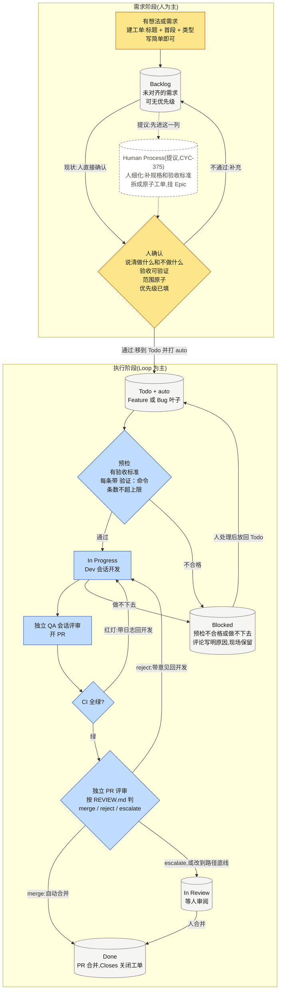

---

name: cycle-workflow
description: Cycle 团队在 itsaplan(infra.CYC)里怎么建、改、拆、整理工单,以及工单从 Backlog 到 Done 的流程。建工单、改标题或正文、选类型和标签、判断能不能进 Todo 或打 auto、拆分或整理存量工单时使用。不管具体怎么实现一个工单,那是工单正文和代码的事。
---

# Cycle 工单规范

适用范围:itsaplan 的 `infra.CYC`。别的项目另议。

工单有两类读者,各读不同的部分:

- **人**扫看板,只看标题。标题要让人判断这是什么、值不值得点开。
- **agent** 开工时读正文。正文要说清做什么、不做什么、怎么验收。

建或改工单前,先按 `clawdot-itsaplan:itsaplan` 的方式取 `get_project` 拿 id,并看同类的邻近工单。

## 流程

- 黄色是人做的,蓝色是 Loop 做的,虚线是还没成立的提议。
- 人是进 Todo 的关口;Loop 只在 Todo 之后动作。
- PR 评审判 `merge` 时 Loop 开启自动合并;改到路径底线(`cloud/loop/src/guard/floor.ts`)的 PR 一律转人。评审标准见根目录 `REVIEW.md`。

## 标题

标题写这件事的**范围和目标**,是稳定的:做到一半它不变,做完它仍然准确。不写当前进展,不写今天剩下的动作(那是正文的事)。

1. **类型不进标题。** 类型是字段。不写 `epic(...)`、`feat(...)`、`fix(...)`、`design(...)`、`Epic：`、`调研：`、`Step 1.1：`。
2. **动作 + 对象。** 对象用用户看得到的名词(界面、功能、产品里的叫法),不用内部名词。`unknown`、`task_update`、`L1`、`_cycle/*` 这类词放正文。
3. **一级工单必须自己讲清楚。** 单独拿出来,没有上下文的人也能说出这是什么、在哪。子任务可以依赖父级的上下文,一级不行。
4. **Bug 写现象**,因为 Bug 的范围就是那个现象。写用户看到了什么,不写猜测的原因。
5. **Feature 写能力**:「支持…」「新增…」「…可以…」。
6. **Design、Research 写要回答的问题或要产出的东西。**
7. **Epic 写这一整块工作的范围和要达成的目标**,一句话划清边界,例如「实现 Loop:完成 auto 标签的工单的最小闭环」。不要写成触发条件加动作的长句,也不要复述机制。
8. **团队已有的专有名词保留在标题里**(Loop、Inbox、Overview 等),不要为了「通俗」把它拆成描述。同一组工单用同一个名字开头,父子在看板上才对得上。第一次出现的名词,在正文第一小节解释。
9. 不写工单编号,不写「重构」「优化」「调研一下」这种没有对象的词,不用括号补充说明来凑清楚(括号里最多放一个必须的别名,如 browser use)。

| 不好                                                               | 好                                                             | 为什么                                          |
| ------------------------------------------------------------------ | -------------------------------------------------------------- | ----------------------------------------------- |
| `epic(browser): 桌面端内置 browser 与 browser use`                 | 桌面端内置浏览器,并支持 agent 操作浏览器                       | 类型在前缀里,与字段还矛盾                       |
| `design(app): 应用图标`                                            | 设计应用图标,并用到 Dock、关于页、更新弹窗等各处               | 只有名词,看不出要做什么                         |
| `feat(protocol,daemon): 状态未知的后台任务可以标记为结束`          | 支持手动结束 Overview 里状态未知的后台任务                     | 前缀是实现位置,不是用户看到的                   |
| 核对应用图标显示正常                                               | (同上)                                                         | 这是今天剩下的活,不是范围                       |
| Todo 里打了 auto 的 Feature/Bug 工单,能自动开发、独立审查并开出 PR | 实现 Loop:完成 auto 标签的工单的最小闭环                       | 复述了触发机制,还丢了团队通用的名字 Loop        |
| Backlog 里的粗需求能自动加工成带可验证验收标准的规格草案,由人批准  | 规划 Loop:自动为 Backlog 里的需求写规格草案和验收标准,由人批准 | 太长,且和同组的 Loop 工单对不上                 |
| 规划 Loop:把粗需求自动加工成规格草案,由人批准                      | (同上一行)                                                     | 「粗需求」是正文里的自造词,标题里没人知道指什么 |

自检:把标题单独发给一个没有上下文的人,他说得出这是什么、在哪吗?说不出就重写。

## 类型

只用五种:

| 类型     | 用在                          | 能被 Loop 拉取 |
| -------- | ----------------------------- | -------------- |
| Epic     | 容器,有子项,自己不直接实现    | 否             |
| Feature  | 要新增或改变一个能力          | 是(叶子)       |
| Bug      | 已有行为不对                  | 是(叶子)       |
| Design   | 产出一个设计或决定,不产出代码 | 是(本地只读的) |
| Research | 要回答一个问题,产出结论       | 是(本地只读的) |

Task、Tech Governance、Operations 等旧类型不再新建。存量的按内容归到上面五种之一。

类型要和实际一致:有子项的是 Epic,不是 Feature;正文是「想法、待讨论」的不是 Feature,是 Design。

## 正文

正文分两层:**首段给人,其余给 agent。**

1. **首段**:正文最前面两三句话,不带小节标题,说清做什么、为什么、做完什么样。人在看板上点开就能读懂,不用往下翻。所有类型都要有,建工单时就要写。
2. **其余小节**:范围、非目标、验收标准等,要精确,agent 照它做事。Backlog 阶段可以先空着,进 Todo 前由人参与补齐(见「从 Backlog 到 Todo」)。

通用规则:

- **正文写当前事实。** 目标、范围、现状变了就重写,不在末尾追加「本轮复核后」之类的段落。过程和历史放评论。
- **不确定的写进「待确认」,不写成事实。** 例如「pi 就是 Pi coding agent」只是假设,就要标成假设。
- **证据放在第一节**:日志、路径、版本、截图,不放结尾。
- 内部名词第一次出现时用一句话解释;团队通用的专有名词不用解释。
- **业务层与执行层分层（Initiative / 一级业务单 / 二级 Task Graph）**:
  - **Initiative**（长期/多 PR 项目）:跨周或超过单个 PR 承载量的产品域，拆成多个可独立排期上线的一级业务单。
  - **一级业务单**（1 单 = 1 分支 = 1 个完整 PR，合并即 Done）:面向业务的完整交付单元（Feature / Bug / Research / Design），有业务价值和端到端验收标准。单个完整能力（即使跨协议、API、UI）保持为 1 张一级业务单，由 Loop 内部二级 Task Graph 分节点接力消化，不按技术层切成子单。
  - **二级 Task Graph**（Loop 内部执行节点，存在 `loop.db`，不是工单）:无业务分类，由 Loop 在同一分支上按拓扑序逐节点执行并打 checkpoint commit，全部通过后统一跑整单验收与独立 QA，交付 1 个 PR。
- **除 Epic 外,进 Todo 的工单是一级业务单**:一个业务目标、一组端到端验收标准、能在一个完整 PR 内交付并验收。只有超过单 PR 承载量，或可以独立排期上线时，才拆成多个一级单；两张工单改同一处、没法单独验收，就合并。Backlog 里的粗糙需求可以在细化时再决定是否拆。
- 用项目的 `issueTemplates`(`get_project` 取)。

### 大档 Plan 的执行图（Task Graph）

带 `完整流程` 标签的大档工单，在 `Plan` 文档的 `## 执行图`（或 `## Task Graph`）小节下用 fenced `json` 代码块声明结构化执行图（JSON 数组或 `{ "nodes": [...] }`）：

- 每个节点字段：`id`（1–32 位小写字母、数字、`-` 或 `_`，禁止以 `fix-` 开头）、`title`、`goal`、`dependsOn`（前置节点 `id` 数组）、`filesHint`（预计改动路径数组）、`verify`（开发节点必须非空，每条为 Loop 允许的验证命令；`role` 为 `research` 的节点可以为空），可选 `role`（只接受 `research`，不写为开发节点）。
- 约束：规划节点上限 8 个（含整单失败时自动追加的 `fix-*` 修补节点总计上限 12 个）；必须为无环 DAG（无自依赖、无悬空依赖、无环）；每条 `verify` 必须通过命令白名单校验。
- 兼容与小档：旧大档无 `## 执行图` / `## Task Graph` 小节时退化为 1 节点；小档工单按体量自适应走 1 节点快路径，或由只读 Planner 自动拆出 2–4 个节点执行。

### 各类型的小节

| 类型     | 首段之后的小节                                                                          |
| -------- | --------------------------------------------------------------------------------------- |
| Feature  | 背景与证据 / 范围 / 非目标 / 涉及面 / 验收标准 / 合并后由人验收(可选) / 依赖与待决      |
| Bug      | 现象 / 复现步骤 / 预期与实际 / 环境与版本 / 严重度 / 根因线索 / 验收标准 / 回归测试豁免 |
| Epic     | 目标 / 范围 / 非目标 / 完成标准                                                         |
| Design   | 要回答的问题 / 背景与约束 / 备选方案 / 结论 / 待决                                      |
| Research | 要回答的问题 / 方法与范围 / 产出形式 / 结论                                             |

- **Epic 的正文不列子工单。** 子项靠父子关系显示;正文里列了会随子项增减而过期。要表达先后,用 `blocks` 链接。
- **Design 和 Research 做完后,回填「结论」小节**,不要往正文末尾追加。结论要回答「要回答的问题」里的每一条。
- Design 的完成标准写成「哪些问题已有结论」,不需要 `验证：` 命令;能进 Loop 的写法见下面「Design 在 Loop 里」。
- Research 不需要 `验证：` 命令;能进 Loop 的写法见下面「Research 在 Loop 里」。

### Research 在 Loop 里

只要本地读代码、跑只读命令就能回答的 Research,可以打 `auto` 交给 Loop。Loop 的预检要求:

- 「要回答的问题」是编号列表(1. 2. 3.),条数不超过 `maxCriteria`。
- 「方法与范围」「产出形式」有内容。「方法与范围」写清只在本地读、不建不删、不装依赖、不联网;做不到的让会话写成「未验证」并给出人可以执行的验证办法。
- 「结论」还没写:空着,或只有一个括号说明,例如「(未完成)」。

流程是:调研 → 独立 QA 核对 → 发布 → Done,不经过 In Review。发布由 Loop 做:

- 完整报告建成「调研」目录下的文档,标题「CYC-NNN 工单标题」,挂到工单上;
- 「结论」只回填一段摘要和报告标题;
- 后续工作起草成 Feature、Bug 工单放进 Backlog,用 `relates` 链接回调研工单,不打 `auto`、不设优先级,等人批准(见「从 Backlog 到 Todo」)。

要联网、要读外部系统(自建 GitLab、网页文档)、要人操作才能回答的,不要打 `auto`,人来做。

### Design 在 Loop 里

只要本地读代码、对比方案就能定下来的 Design,可以打 `auto` 交给 Loop(项目配置里 `design` 段打开才会领)。写法同 Research,Loop 的预检要求:

- 「要回答的问题」是编号列表(1. 2. 3.),条数不超过 `maxCriteria`。
- 「背景与约束」有内容。
- 「结论」还没写:空着,或只有一个括号说明。

流程同 Research:设计会话只读,对比备选方案并给出推荐 → 独立 QA 核对 → 发布 → 直接 Done,不经过 In Review。报告建成「设计」目录下的文档并挂到工单,「结论」逐条回答问题,后续工作起草成 Feature、Bug 放进 Backlog。要人拍板、要联网或要人操作才能定的设计,不要打 `auto`。

### Plan 里声明调研节点

功能需求的执行图里,节点可以写 `"role": "research"`,让只读的调研会话先回答一个问题,结论(完整报告)交给依赖它的开发节点。调研节点的 `goal` 写要回答的问题,`verify` 可以不写。只允许 `research`:写 `design` 或 `qa` 预检不通过(QA 节点由 Loop 追加)。调研节点计入规划节点上限 8 和节点总数上限 12。

### 验收标准(Feature、Bug)

Loop 的预检只认这一节,格式是硬约束:

- 小节标题必须是 `## 验收标准`(或「验收」「acceptance criteria」)。
- 每条是一个列表项,必须带 `验证：` 加一条 Loop 允许的命令:`bun run check`、`bun run test:browser`、`bun run test:integration [套件]`、`bun test ./<路径>`(路径以 `./` 开头)。只能人看的现象不写在这一节,放进下面的「合并后由人验收」。
- 条数有上限(`maxCriteria`),超了说明工单太大,要拆。

**界面现象怎么写成验收命令**(不新增命令,用现有的三种):

1. 整页流程(打包后的应用、浏览器里的端到端):`bun run test:integration web`,约 8 秒。Loop 运行时会补 `--strict`,所以没 build、没 Chromium 而整个跳过的会判失败;不要自己写 `--strict`。
2. 组件:`bun run test:browser`,在无界面的 Chromium 里跑,约 78 秒。
3. 其他测试文件:`bun test ./路径`,如 `bun test ./apps/desktop/test/integration/web.integration.ts`。路径必须以 `./` 开头(不带 `./` 时 bun 把它当成名字过滤,可能一个测试都找不到),不能以 `/` 开头、不能含 `..`、不能带 `--` 选项。Loop 会读汇总行:通过数为 0(全部跳过)或读不出汇总行,判未通过;有通过也有跳过算通过。

不能写 `test:real` 系列:没有 token 时它整个跳过、退回码是 0,不能当验收。为什么退回码 0 不等于通过,见[决定笔记](../../../.agents/notes/2026-11-26-loop-exit-code-zero-is-not-always-a-pass.md)。

### 合并后由人验收(可选)

只能人看的现象(界面看起来对不对、真实环境里走一遍),写在 `## 合并后由人验收(不进 Loop)` 小节,一条一句。Loop 不读这一节,它不挡 `auto`;PR 合并后由人逐条核对,不对就开 Bug。能写成测试的,优先写进验收标准。

## 层级与关联

- **业务层优先扁平（Initiative + 一级业务单），执行层归二级 Task Graph**:
  - 长期/跨周/多 PR 的大块工作归入 **Initiative**，拆成多个可独立排期上线的一级业务单；单个完整需求（1 单 = 1 PR）不建 Epic、不切技术子单，由 Loop 内部二级 Task Graph 消化。
  - 存量 Epic 与过渡期子单按原流程自然消化关闭；若仍使用 Epic 容器，保持最多两级（Epic 在上，叶子在下，不出现第三级）。
- 子项或一级业务单之间的先后靠 `blocks` / `relates` 链接,不靠标题里写步骤序号。
- 调研或设计还没出结论时,不要提前把实现拆成很多张。先建 Design 或 Research,出结论后再决定怎么拆。

### 拆分一张工单

**拆分口径**：只有**超过单 PR 承载量**，或**可以独立排期上线**时，才拆成多个一级业务单。单次可 1 PR 交付的全栈/跨模块需求保持为 1 张一级单，由 Loop 内部二级 Task Graph 分节点消化，不要拆成 API/UI 等技术子单。

确需拆成多张可独立排期上线的一级业务单时：

1. **原工单挂在 Epic 下**:原工单留作第一份,收窄标题和正文;其余各份建成同一个 Epic 下的兄弟,不要让原工单变成父级(那会出现第三级)。
2. **原工单是独立的**:若归属已有 Initiative 则拆为同 Initiative 下的独立一级单，若走兼容 Epic 容器则将其改成 Epic(正文按 Epic 小节重写,不列子项)并把各份建成子工单。
3. **每一份都要完整**:每份都是可独立排期上线、能以 1 个完整 PR 交付的一级业务单，有自己的首段、小节和验收标准。正文只写原工单里有的内容,原文没有的写「待确认」,不编造;原文每一句都要落在某一份里,不丢信息。
4. **依赖要重新落位**:原工单上的 `blocks` 链接,按内容判断属于哪一份;拿不准就留在第一份,并在评论里说明。份与份之间的先后用 `blocks`。
5. **在原工单加一条评论**:说明拆成了哪几张、为什么。不在正文里写拆分历史。
6. **不靠删除收尾**:误建的工单移到 Canceled 并说明原因;删除要有权限的人来做。

## 标签与优先级

- 领域标签(研发、产品)不强制。
- `auto`:三条都满足才能打。(1) 是 Feature 或 Bug 的叶子;(2) 验收标准每条都带 `验证：` 加允许的命令(要人看的放「合并后由人验收」,不算在内);(3) 已经过人的确认(见下)。
- Research 的 `auto`:是叶子,符合「Research 在 Loop 里」的写法,并由人打。人打 `auto` 就是认定这张调研只需本地只读;这一条规则判断不了,所以不能由 agent 或自动排产代打。
- `完整流程`:要求 Intent、Spec、Design、Plan 四份文档已关联且被人采纳。四份文档默认由 AI 起草,人逐份审阅、修改、采纳(锁定)。
- 优先级:离开 Backlog 进入 Todo 前必填。Backlog 里可以没有,等人或 Loop 的规划节点处理需求后再定。
- 规划节点用的三个标签(见「Loop 的规划节点」):
  - `待批准`:规划节点打。已加工、已过预检和 QA,等人批准。
  - `待回答`:规划节点打。它在评论里问了问题;人回答后摘掉,工单重新参加盘点。
  - `Loop 跳过`:人打(或在 Loop 页面退回时打)。规划节点不再碰这张;摘掉就恢复。

## 从 Backlog 到 Todo

Backlog 是还没对齐的需求,Todo 是「可以被拿走去做」。Loop 只拉 Todo 里带 `auto` 的叶子工单,所以进 Todo 这一步,就是需求对不对齐的最后一道关口。

- **这一步必须有人参与。** 人确认三件事:要做什么和不做什么说清楚了;验收标准是对的、能验证;范围是原子的、一次能做完。确认后,才能把工单移到 Todo、打 `auto`。
- 详细的拆分和规格,在这一步由人参与时做。Backlog 里只要有标题、首段和类型。
- **规格和验收标准默认由 AI 起草,人负责批准。** agent 和规划 Loop 起草规格、补全验收标准、建议拆分;起草时不编造事实,原文没有的写「待确认」。它们**不能自己把工单推进 Todo**,也不能自己打 `auto`:产出留在 Backlog,人看过、改过、同意后才推进。
- 进 Todo 前要齐:优先级、父级(或明确独立)、首段和必填小节、验收标准。
- 没经人确认就进了 Todo 的工单,视为需求未对齐:移回 Backlog,并在评论里写缺什么。

### Loop 的规划节点

Loop 的「找任务」节点在 Todo 里没有能领的单时,会自己从 Backlog 补货(CYC-322,文档「[CYC-322] 规划 Loop」):

1. 盘点整个 Backlog 的 Feature、Bug 叶子(不含 `完整流程`、`auto`、`待批准`、`待回答`、`Loop 跳过`),归成能做、要问、要拆、不适合,并调整优先级(改了会在评论里写理由)。
2. 对排在前面的几张加工:改写标题、正文和验收标准,或按「拆分一张工单」拆开;原文存在评论「加工前的工单」里,说明在以「Loop 规划」开头的评论里。每张都过预检和独立 QA。
3. 加工好的打 `待批准`,**留在 Backlog**。要问的在评论里提问并打 `待回答`。

人在 Loop 页面(或 itsaplan 里按 `待批准` 筛)看草案:同意就批准(移到 Todo 并打 `auto`,摘掉 `待批准`);不同意就改正文、写评论,或打 `Loop 跳过`。规划节点自己从不移列、不打 `auto`(代码层面没有这两个操作)。待批准的堆到上限(默认 5 张)就不再加工。

## 现在还没成立的规则

下面的规则是目标,代码或流程还没做到。不要把它们当作已经成立,也不要让别人以为有机制保证:

| 规则                             | 现状                                                                          | 跟踪    |
| -------------------------------- | ----------------------------------------------------------------------------- | ------- |
| 进 Todo 和打 `auto` 必须由人确认 | 规划节点从代码上做不到;但人和其他 agent 推进时,Loop 不检查是谁推进的,全靠约定 | CYC-375 |
| Loop 页面里整批批准待批准的工单  | 还没做,先在 itsaplan 里按 `待批准` 筛出来逐张批准                             | CYC-451 |

这些改动在 `cloud/loop/`,属于大档,要走 intent / spec / design / plan。落地后,把对应行从这张表删掉,并改相关小节的措辞。

## 整理存量

- 只改未完成的工单,除非用户另有要求。已完成的不动。
- 不直接改。先出对照清单:工单号、原标题、新标题、类型是否要改,交给人评估,确认后才写回。
- 顺序:先标题和类型,再正文,最后拆分。每一步写回前都要给人看对照,拆分前要先让人确认。
- 改标题时同时核对类型和正文是否一致。不一致的(例如 Feature 写成想法、Epic 没有子项)只在清单里提出,不擅自改类型。
- 正文整理只改格式和结构,不新增事实;原文没有的写「待确认」。
- 给 agent 分批整理时:
  - 按工单号切成互不重叠的组,每组只读不写,先出结果再统一写回。
  - 写回前对比当前正文和读取时的正文,被别人改过的不覆盖;只差格式(自动加链接、空行)的可以覆盖。
  - 写入用工单的内部 id,不是 CYC 编号;写完回读,核对内部 id 对应的编号。
  - 对照表会过期,写回时以 itsaplan 里的当前标题为准,不要把旧对照表写回去。
