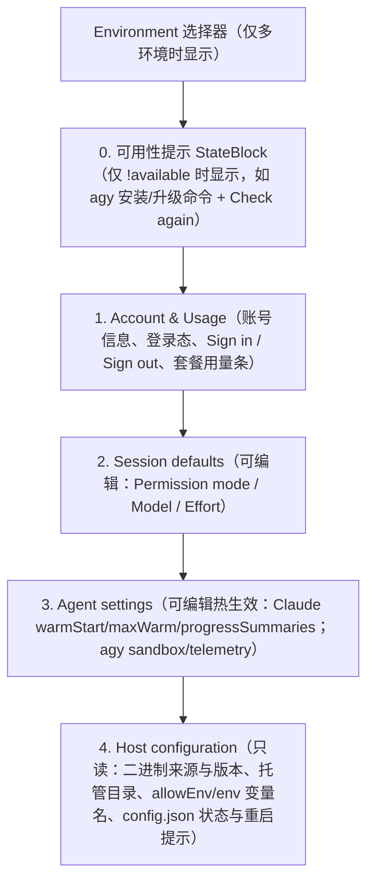

# Harness 设置与配置设计（Claude / Codex / Antigravity）

状态：设计方案与实现计划，尚未开始实现。验证与调研日期：2026-11-23。

对应决定笔记：[2026-11-23-harness-settings-account-login-and-runtime-config.md](../.agents/notes/2026-11-23-harness-settings-account-login-and-runtime-config.md)（取代 [2026-11-22-claude-config-status-not-values.md](../.agents/notes/2026-11-22-claude-config-status-not-values.md)）。

## 1. 背景与目标

Cycle 目前已支持 3 个 agent（`claude`、`codex`、`agy`），后续还会接入 `pi`。现有的 agent 配置分散在多处且存在明显断层：

- **设置页割裂**：Settings 目前只有平铺的 `Defaults` 页管理会话默认项（`mode` / `model` / `effort`），看不到账号登录态、套餐用量、二进制可用性/版本，也看不到宿主 `config.json` 的诊断信息。
- **登录与登出依赖终端**：界面无法直接发起账号登录或登出，也无法区分“未登录 / 订阅登录 / `config.json` 环境变量覆盖 / 未安装 / 配置写坏”。
- **运行开关不可热改**：`claude.warmStart`、`claude.progressSummaries`、`agy.sandbox`、`agy.telemetry` 等非敏感行为选项只能手改 `config.json` 并重启 daemon。

本方案将 Settings 重构为包含 **Harness 分组** 的导航结构，为每个 agent 提供统一、清晰的设置页：**上半区为账号与套餐用量（支持界面内订阅登录/登出），下半区为 Cycle 托管的 agent 层级配置（部分可编辑热生效，部分只读诊断）**。

## 2. 范围边界与安全红线

1. **只支持账号订阅登录，不做 API Key UI 配置**：
   - Claude / Codex / Antigravity 在本轮仅提供**订阅账号的登录与登出**；API Key / 自定义 Base URL / 多模型 provider 的 UI 配置留待接入 `pi` 时统一处理。
   - 若用户已在 `config.json` 的 `env` 里手写了密钥或 token（如 `ANTHROPIC_API_KEY`），界面仅**只读展示**生效来源（变量名），绝不返回值、不提供编辑。
2. **守住凭证不上 L1 红线**：
   - 任何 OAuth token、API key、refresh token 永不经 L1 传输、永不进入前端状态或埋点。
   - 登录流程在 daemon 侧由 agent 官方 CLI / app-server 执行；L1 仅传递授权页 URL / Device Code（daemon → client）以及 hosted-callback 模式下的一次性授权码（client → daemon，供 Claude / agy 写入登录子进程 stdin）。
   - 主进程打开任何来自 daemon 的授权链接前，必须经 `openableAuthorizationUrl`（`@cycle/oidc` 的 `allowedEndpoint`）校验。
   - **`agy` 硬红线不变**：绝不读取、解析、存储或转发 `agy` 的 OAuth token 文件；仅驱动 `agy acp --login` 与 `agy acp` `logout` RPC（见 [2026-11-23-agy-terms-distribution-and-telemetry.md](../.agents/notes/2026-11-23-agy-terms-distribution-and-telemetry.md)）。
3. **只管 Cycle 托管配置，不碰 agent 原生配置与宿主目录**：
   - 不提供“切换到本机已有 `~/.claude` / `~/.codex` / `~/.gemini` 登录”的 UI 选项；始终默认使用 `<dataDir>/<id>` 隔离目录（用户手改 `config.json` 时只读标注为自定义）。
   - 不读写 agent 原生配置文件（`CLAUDE.md`、`settings.json`、`config.toml` 等）；`Plugins` 保留在 Connectors 页面。

## 3. 前置隔离探测结论（实现依据）

2026-11-23 在严格隔离的临时目录（`env -i`，未触碰本机任何真实目录或钥匙串）下，对仓库锁定的 3 个二进制做了只读实测探测：

- **Claude**：`2.1.327`（`@anthropic-ai/claude-agent-sdk@0.3.327`）
- **Codex**：`0.171.0`（`@openai/codex@0.171.0`）
- **Antigravity (`agy`)**：`1.5.15`

| 能力               | Claude (`2.1.327`)                                                                                                                                                                                                                                                   | Codex (`0.171.0`)                                                                                                                                                                                                                                  | Antigravity (`1.5.15`)                                                                                                                                                                                                                   |
| ------------------ | -------------------------------------------------------------------------------------------------------------------------------------------------------------------------------------------------------------------------------------------------------------------- | -------------------------------------------------------------------------------------------------------------------------------------------------------------------------------------------------------------------------------------------------- | ---------------------------------------------------------------------------------------------------------------------------------------------------------------------------------------------------------------------------------------- |
| **账号状态查询**   | `claude auth status --json`（约 0.3s）：返回 `loggedIn`、`authMethod`（`none`/`api_key`/`oauth_token`/`third_party` 等）、`apiProvider`、`apiKeySource`；OAuth 登录时附带 `email` / `organization` / `subscriptionType` / `loginExpiresAt`（SDK `AccountInfo` 同构） | `codex -c cli_auth_credentials_store="file" app-server` 的 `account/read` RPC：返回 `account`（`null` / `chatgpt { email, planType, workspaceName }` / `apiKey` / `amazonBedrock` / `gcp`）                                                        | 无独立 `auth status` 子命令；通过 `agy models`（未登录 exit 1 报 `Please sign in`，已登录 exit 0）探测登录态；会话建立时从 `_meta.antigravity.tier` 缓存订阅档位                                                                         |
| **OAuth 登录流程** | `claude auth login --claudeai`（配 `BROWSER=/usr/bin/true`）：`redirect_uri` 为 **`https://platform.claude.com/oauth/code/callback`**（非 localhost），stdout 打印授权 URL 并等待 stdin 粘贴 code → **本地与远端 SSH 同一套流程**                                    | `codex app-server` `account/login/start` + `account/login/cancel`：<br>- **本地**：`type: "chatgpt"`（回调 `127.0.0.1:1455`，自动完成）<br>- **远端 SSH**：`type: "chatgptDeviceCode"`（返回 `verificationUrl` + `userCode`，无需 localhost 回调） | `agy acp --login`（配 `BROWSER=/usr/bin/true`）：`redirect_uri` 为 **`https://antigravity.google/oauth-callback`**（非 localhost），stdout 打印 Google OAuth URL 并等待 stdin 粘贴授权码或跳转后完整 URL → **本地与远端 SSH 同一套流程** |
| **登出流程**       | `claude auth logout`（幂等，未登录亦 exit 0）                                                                                                                                                                                                                        | `codex app-server` `account/logout`（或 `codex logout`）                                                                                                                                                                                           | `agy acp` 原生 RPC `logout`（实测返回 `{}`）                                                                                                                                                                                             |
| **套餐用量**       | 被动来自会话 `rate_limit_event` → daemon 内存 `_cycle/plan_usage`（5h / 7d / 按模型）；未对话前暂无数据                                                                                                                                                              | `account/rateLimits/read` **可主动随时查询**（5h / 7d 窗口），回合中亦自动推送更新                                                                                                                                                                 | `agy` 1.5.15 不暴露额度窗口，仅支持展示已知订阅档位                                                                                                                                                                                      |

额外记录两条备忘（本轮不做 API Key，留待后续 `pi` / 多 provider 阶段参考）：

- 仅在环境变量传 `OPENAI_API_KEY` 时，`codex login status` 与 `account/read` 仍报未登录；Codex 需要经 `account/login/start { type: "apiKey" }` 或 `codex login --with-api-key` 写入 `$CODEX_HOME/auth.json`。
- `agy acp` 虽在 `initialize` 声明了 `gemini-api-key`，但仅设 `GEMINI_API_KEY` 环境变量直接 `session/new` 会报 `-32000`，必须先调 ACP `authenticate({ methodId: "gemini-api-key" })`。

## 4. 界面信息架构（Settings → Harness）

### 4.1 左侧分组导航

扩展 `packages/ui/src/react/page-layout.tsx` 支持分组标题（保持完整上下方向键 / Home / End 键盘导航）：

```text
Settings
├── General
├── Appearance
├── Environments
├── Shortcuts
│
├── HARNESS                    ← 分组标题（非可选项）
│   ├── [Claude Logo] Claude
│   ├── [Codex Logo]  Codex
│   └── [Agy Logo]    Antigravity
```

- Harness 子项按当前选中环境的 `_cycle/agents/list` 动态生成，未来加入 `pi` 时自动出现；旧版 daemon 不含某 agent 时自动不显示。
- 原 `Defaults` tab 移除，其内容作为每个 Harness 页的 “Session defaults” 区块。
- 当连接了多个环境时，Harness 页顶部显示共享的 **Environment 选择器**（仅本机连接时隐藏）。

### 4.2 单个 Harness 页布局（自上而下）



1. **Account & Usage（第一部分）**
   - **状态行**：`StatusDot` + 身份主标题（如邮箱 / `Signed in` / `Not signed in` / `Configured via config.json`）+ 副标题（认证方式、订阅计划/工作区、过期时间或 `config.json` 覆盖提示）。
   - **操作按钮**：
     - 未登录 / 可重登：`Sign in`（本地 Codex 自动走浏览器流，远端 Codex 自动走 Device Code 弹窗；Claude / agy 走统一授权弹窗：一键在浏览器打开链接 + 粘贴授权码输入框 + 提交/取消）。
     - 已登录（且非纯 `config.json` env 覆盖）：`Sign out`（先弹 `ConfirmDialog` 确认）。
     - `Refresh`：重查账号态；Codex 同时主动刷新套餐用量。
   - **套餐用量**：抽取 `packages/ui/src/react/context-details.tsx` 中的用量进度条为可复用组件 `PlanUsageBars`：
     - **Codex**：进页自动读 + 点 Refresh 刷新，显示 5 小时与每周窗口及重置倒计时。
     - **Claude**：展示 daemon 已收到的最新未过期窗口；尚无数据时显示温和说明“将在完成一次对话后显示”。
     - **Antigravity**：不渲染空白额度条；若已有档位信息则展示在账号副标题中。

2. **Session defaults（可编辑，立即对新会话生效）**
   - 沿用现有 `AgentDefaultsFields` + `ConfigForm`，读写 `_cycle/agent_defaults/*`（`<dataDir>/agent-defaults.json`）。

3. **Agent settings（可编辑，热生效，不重启 daemon）**
   - 由 daemon 在 `_cycle/agent_setup/read` 返回声明式 `runtime.schema` 与当前 `runtime.values`，UI 动态渲染，不写死 agent id：
     - **Claude**：
       - `warmStart`（Switch）：新建会话时提前启动进程以预载命令列表
       - `maxWarm`（仅 `warmStart` 开启时可调，整数 1–10）：最多保留的预热会话数
       - `progressSummaries`（Switch）：为运行中的子 agent 定期生成模型进度摘要
     - **Codex**：当前 schema 为空，不渲染该组（后续加选项自动出现）。
     - **Antigravity**：
       - `sandbox`（Switch）：以 `--sandbox` 启动 `agy acp`
       - `telemetry`（Switch，默认 `true`，遵循既有决定笔记不静默关闭；关闭时传 `--disable-telemetry`）

4. **Host configuration（只读诊断，不经 UI 修改）**
   - **Binary**：来源（Built-in / Configured in `config.json` / System PATH / Missing）、路径与版本号（`agy` 同时展示最低版本要求 `>= 1.5.10`）。
   - **Managed directory**：`<dataDir>/<id>` 或标注 `Custom (config.json)`。
   - **Environment variables**：`allowEnv` 允许透传的变量名列表；`env` 中声明的变量名列表（**仅变量名，绝不返回值**）。
   - **`config.json` status**：文件路径（本机提供“在文件管理器中显示”，远端提供一键复制路径）；若文件存在语法/schema 报错则用 `StateBlock` 展示原错；若文件 mtime 晚于 daemon 启动时间，提示“配置文件已修改，重启 daemon 后生效”。

## 5. L1 协议设计（`docs/protocol.md` & `packages/protocol`）

实现前先更新 [protocol.md](protocol.md)（新增“Harness 状态、认证与运行时配置”一节），再在 `packages/protocol/src/agent-setup.ts` 定义全部 Zod schema：

### 5.1 能力位扩展（`packages/protocol/src/meta.ts`）

- `CapabilitiesSchema` 新增 `agentSetup: z.boolean().optional()`。
- 旧 daemon 未声明 `agentSetup: true` 时，Settings → Harness 页仍可用，仅展示 `Session defaults` 并隐藏需要新接口的区块（平滑降级）。

### 5.2 L1 方法与通知

| 方法 / 通知                      | 方向          | 参数                                                    | 返回 / 载荷                                                                                                                                                                     |
| -------------------------------- | ------------- | ------------------------------------------------------- | ------------------------------------------------------------------------------------------------------------------------------------------------------------------------------- |
| `_cycle/agent_setup/read`        | C → D         | `{ agent, refreshUsage? }`                              | `AgentSetupSnapshot`（`available`、`binary`、`auth`、`planUsage?`、`canRefreshUsage`、`runtime { schema, values }`、`environment { configFile, dataDir, allowEnv, envNames }`） |
| `_cycle/agent_setup/set_runtime` | C → D         | `{ agent, settings }`                                   | `{ values }`（经 harness 校验后原子落盘 `<dataDir>/agent-settings.json` 并热生效，同时广播 `_cycle/agent_setup_changed`）                                                       |
| `_cycle/agent_auth/start`        | C → D         | `{ agent, mode: "browser" \| "code" \| "device_code" }` | `{ flowId, mode, authorizationUrl?, verificationUrl?, userCode? }`                                                                                                              |
| `_cycle/agent_auth/submit`       | C → D         | `{ flowId, code }`                                      | `{ ok, error? }`（用于 `"code"` 模式向运行中的登录进程提交授权码）                                                                                                              |
| `_cycle/agent_auth/cancel`       | C → D         | `{ flowId }`                                            | `{}`                                                                                                                                                                            |
| `_cycle/agent_auth/logout`       | C → D         | `{ agent }`                                             | `{}`（登出并清掉 daemon 内存中该 agent 的 `planUsage`，广播 `_cycle/agent_setup_changed`）                                                                                      |
| `_cycle/agent_auth_completed`    | D → C（通知） | —                                                       | `{ flowId, agent, ok, error? }`                                                                                                                                                 |
| `_cycle/agent_setup_changed`     | D → C（通知） | —                                                       | `{ agent }`                                                                                                                                                                     |

## 6. Daemon 与 Harness 存储/热生效架构

### 6.1 新增 `<dataDir>/agent-settings.json`（不改写手写 `config.json`）

- 新增 `apps/daemon/src/agent-settings.ts`（`AgentSettings` 类，沿用 `defaults-file.ts` 的原子临时文件 + rename 写入模式，`version: 1`）。
- **合并优先级**：`agent-settings.json`（UI 修改的覆盖项） > `config.json`（启动时加载的宿主配置） > schema 默认值。
- **热生效机制**：
  - `apps/daemon/src/agents.ts` 的 `AgentDefinition` 扩展：
    - `maxAhead?: number | (() => number | undefined)`（使 Claude 的 `warmStart`/`maxWarm` 修改后立即影响预热上限）
    - `setup?: AgentSetupProvider`（与 `plugins?: PluginProvider` 平行的可选接口，daemon 核心不按名字硬编码任何 agent）
  - `claude-agent.ts` 与 `agy-agent.ts` 的 `launch()` 每次启动子进程时从 `AgentSettings` 读取最新有效运行时选项并序列化进 `CYCLE_ADAPTER_CONFIG`——**下个新会话立即生效，不打断运行中的会话**。
- **`config.json` 诊断**：`serve.ts` 记录启动时 `config.json` 的 `mtimeMs`（及不存在标记）；`_cycle/agent_setup/read` 实时对比当前文件 mtime 与读取/校验结果，判断 `stale` 与 `error`。

### 6.2 三个 Harness 的 `AgentSetupProvider`

- **Claude**（`apps/daemon/src/claude-setup.ts`）：
  - `readAuth()`：用 `claudeEnv` 执行 `claude auth status --json`（5s 超时），解析身份、认证方式和 `viaEnv`。
  - `startLogin("code")`：用 `claudeEnv` + `BROWSER=/usr/bin/true` 启动 `claude auth login --claudeai`，提取 stdout 中的授权 URL；收到 `submit(code)` 后写入 stdin，等待进程退出并广播 `_cycle/agent_auth_completed`。
  - `logout()`：用 `claudeEnv` 执行 `claude auth logout`。
- **Codex**（`apps/daemon/src/codex-setup.ts`）：
  - `readAuth({ refreshUsage })`：确保 `CODEX_HOME` 存在（0700），启动短生命周期 `codex -c cli_auth_credentials_store="file" app-server`，调用 `account/read`；若为 ChatGPT 登录且需刷新用量，调用 `account/rateLimits/read` 并用 `planWindowsOf()` 更新 daemon 的 `planUsage`。
  - `startLogin("browser" | "device_code")`：保持该次登录的 `app-server` 存活，调用 `account/login/start`（`chatgpt` 或 `chatgptDeviceCode`），监听 `account/login/completed` 通知后退出并广播 `_cycle/agent_auth_completed`；支持 `account/login/cancel` 与超时回收（10 分钟）。
  - `logout()`：调用 `account/logout`。
- **Antigravity**（`apps/daemon/src/agy-setup.ts`）：
  - `binary`：复用 `findAgyExecutable`，返回来源、路径、实际版本、`minVersion: "1.5.10"` 及具体 `problem`（`missing` / `outdated` / `not_executable`）。
  - `readAuth()`：用隔离 `agyEnv` 执行 `agy models`（5s 超时）判断 `signed_in` / `signed_out`（绝不读取任何 token 文件）；结合 daemon 内存中记录的最新 `_meta.antigravity.tier` 展示订阅档位。
  - `startLogin("code")`：确保 `env.HOME` 存在（0700），用 `agyEnv` + `BROWSER=/usr/bin/true` 启动 `agy acp --login`（若当前有效 `telemetry === false` 追加 `--disable-telemetry`），解析 Google OAuth URL，收到 `submit(code)` 写入 stdin 并等待退出。
  - `logout()`：启动短生命周期 `agy acp --process-per-session`，发 `initialize` + `logout` 后关闭。

### 6.3 桌面端与空白页联动

- **主进程**（`apps/desktop/src/main/manager.ts` / `dispatch.ts` / `app.ts`）：
  - 桥接全部 `agentSetup` / `agentAuth` 方法到 `AppApi`；对本地环境提供 `revealDaemonConfig()`（通过 Electron `shell.showItemInFolder` 显示本机 `<dataDir>/config.json`）。
  - 收到登录 URL 后经 `openableAuthorizationUrl` 校验，由 `shell.openExternal` 打开浏览器。
- **空白页联动**（`packages/ui/src/react/blank.tsx`）：
  - 当会话因未登录（`-32000`）或 agent 不可用失败且 daemon 支持 `agentSetup` 时，除保留复制命令外，增加直达对应 Harness 设置页的操作按钮（`Open <Agent> settings`），形成完整闭环。

## 7. 埋点设计（`packages/analytics` & `docs/analytics.md`）

严格遵守“只报行为、不报内容、禁用 `z.string()`”规则（见 [analytics.md](analytics.md)）：

- `settingsSection` 枚举更新为 `["general", "appearance", "environments", "shortcuts", "harness"]`（同步更新 `SETTINGS_SECTIONS` 与 `apps/desktop/test/preferences.test.ts`）。
- 新增事件（同步写入 `packages/analytics/src/events.ts` 与 `docs/analytics.md`）：
  - `harness_settings_shown`: `{ agent, environment }`（UI 事件，切换查看某个 Harness 子 tab 时上报）
  - `agent_auth_started`: `{ agent, environment, mode: "browser" | "code" | "device_code" }`（主进程上报）
  - `agent_auth_completed`: `{ agent, environment, result: "ok" | "failed" | "cancelled" }`（主进程上报）
  - `agent_signed_out`: `{ agent, environment, ok: boolean }`（主进程上报）
  - `agent_runtime_settings_saved`: `{ agent, environment }`（主进程上报）
- **明确不上报**：email、organization、plan 原始名、文件路径、环境变量名、授权码、URL、错误信息原文。

## 8. 分阶段实现与验证计划

### Phase 1：协议文档与 `@cycle/protocol`

- 更新 [protocol.md](protocol.md)（新增 Harness 设置、账号认证与运行时配置章节及 `agentSetup` 能力位）。
- 新增 `packages/protocol/src/agent-setup.ts`，更新 `packages/protocol/src/meta.ts`、`index.ts` 及单元测试。

### Phase 2：Daemon 运行时配置存储与 3 个 Harness Setup Provider

- 新增 `apps/daemon/src/agent-settings.ts`（原子持久化 + 校验 + 与 `config.json` 合并）。
- 扩展 `AgentDefinition`（动态 `maxAhead` + `setup?: AgentSetupProvider`），改造 `claude-agent.ts`、`agy-agent.ts`、`serve.ts`、`daemon.ts` 实现全部新 L1 方法、登录流生命周期管理（单 agent 互斥、取消、10 分钟超时、daemon 停止时清理子进程）与通知广播。
- 实现 `claude-setup.ts`、`codex-setup.ts`、`agy-setup.ts` 及其隔离单元测试（使用假二进制/假 app-server/假 ACP v1，验证环境变量白名单与红线）。

### Phase 3：`@cycle/client`、桌面端主进程/预加载与埋点

- 在 `packages/client` 封装全部 L1 方法与事件订阅，补齐单元测试。
- 在 `apps/desktop/src/main`（`manager.ts`、`dispatch.ts`、`app.ts`）、`preload`、`packages/ui/src/api.ts` 接入 IPC、`openableAuthorizationUrl` 校验打开浏览器、本地 `revealDaemonConfig`。
- 在 `packages/analytics/src/events.ts` 与 `docs/analytics.md` 同步新增埋点事件，并编写测试验证事件发出且不携带任何敏感字段或自由字符串。

### Phase 4：Settings → Harness UI、样式、国际化与空白页联动

- 扩展 `packages/ui/src/react/page-layout.tsx` 及样式支持分组左侧导航；更新 `settings-sections.ts`、`settings.tsx`、`app.tsx`。
- 抽取 `PlanUsageBars` 供 `context-details.tsx` 与 Harness 页复用。
- 新建 `packages/ui/src/react/harness-settings.tsx`（含 Account & Usage、Sign-in/Code/Device-code 弹窗、Session defaults、热生效 Agent settings、Read-only Host configuration）。
- 更新 `blank.tsx` 增加直达 Harness 设置页的入口；补全 `en-US.ts` 与 `zh-CN.ts` 文案。

### Phase 5：全量验证与文档同步

- 运行门禁 `bun run check`（边界、类型、lint、全部单测）。
- 编写并运行浏览器 UI 测试 `bun run test:browser`（覆盖分组导航、3 个 Harness 页展示、登录/登出/粘贴 code/Device Code 流程、运行时开关热保存、只读诊断与旧 daemon 降级）。
- 运行集成测试 `bun run test:integration`。
- 更新 [daemon.md](daemon.md) 与 [desktop.md](desktop.md) 对应章节。
