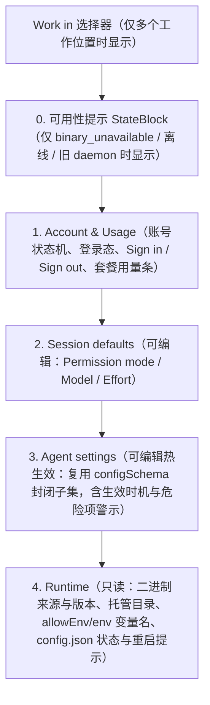

# Harness 设置与配置设计（Claude / Codex / Antigravity）

> **历史文档。** 这是 Epic CYCL-226(已完成)当时的设计和实测记录，按当时的写法保留，不随代码更新。设置页现在的行为以 [desktop.md 的设置页一节](desktop.md#设置页cycl-56)为准。

状态：已实现（Epic `CYCL-226`，子任务 `CYCL-227`–`CYCL-237` 全部落地并通过全量验证）。设计及实测日期：2026-11-23。

> **前置隔离实测结论（2026-11-23，macOS arm64，全部在独立临时目录运行、零触碰真实主目录）**：
> 1. **Codex（`codex-cli 0.166.0`）**：同一隔离 `$CODEX_HOME` 下，长驻 session `app-server` 与短生命周期认证 `app-server` 并发执行 `account/read`、`account/rateLimits/read`、`account/logout`、`account/login/start`、`account/login/cancel` **无 SQLite / 文件锁冲突**；`account/login/start { type: "chatgptDeviceCode" }` 实测返回 `verificationUrl: "https://auth.openai.com/codex/device"`（精确匹配桌面端硬编码白名单 `auth.openai.com`），`account/login/completed` 通知载荷为 `{ loginId, success, error }`。
> 2. **Claude（`claude` CLI）**：在隔离 `CLAUDE_CONFIG_DIR` + `HOME` 下，`claude auth status --json` 明确返回 `loggedIn: false` 且作用域严格隔离于宿主 `~/.claude`（macOS 钥匙串条目按 `CLAUDE_CONFIG_DIR` 隔离）；非 TTY 管道下 `BROWSER=/usr/bin/true claude auth login --claudeai` 稳定输出 `https://claude.com/cai/oauth/authorize?...` 与 `Paste code here if prompted > ` 提示；`claude auth logout` 干净退出（exit 0）。
> 3. **Antigravity（`agy` CLI）**：隔离 `HOME` 未登录时 `agy models` 实测约 `1.55s`（exit 1，`Error: Please sign in to view available models...`），设置 15s 超时 + 45s 短 TTL 内存缓存（`forceRefresh` 绕过、登出/登录完成立即失效）；非 TTY 管道下 `BROWSER=/usr/bin/true agy acp --login` 稳定输出 `https://accounts.google.com/o/oauth2/auth?...` 与粘贴提示；`agy acp` 原生 `logout` RPC 返回 `{}`，全程不触碰任何 token 文件。

对应决定笔记：[2026-11-23-harness-settings-account-login-and-runtime-config.md](../.agents/notes/2026-11-23-harness-settings-account-login-and-runtime-config.md)（部分取代 [2026-11-22-claude-config-status-not-values.md](../.agents/notes/2026-11-22-claude-config-status-not-values.md)，后者关于“只返回变量名、变量名不进埋点、mtime 提示、重启沿用 `--wait/--force`、拒绝 API Key 上线路”的规则继续有效）。

> **2026-11-24 更新**:本文的 "Account & Usage" 一节(账号状态、登录登出、套餐用量)已从 Harness 页挪到设置页的 **Model providers → Subscriptions**(见 [desktop.md](desktop.md)),Harness 页只留可用性提示、Session defaults、Agent settings、Runtime。下文按挪动前的写法保留,行为不变。

## 1. 背景与目标

Cycle 目前已支持 3 个 agent（`claude`、`codex`、`agy`），后续还会接入 `pi`。现有的 agent 配置分散在多处且存在明显断层：

- **设置页割裂**：Settings 目前只有平铺的 `Defaults` 页管理会话默认项（`mode` / `model` / `effort`），看不到账号登录态、套餐用量、二进制可用性/版本，也看不到宿主 `config.json` 的诊断信息。
- **登录与登出依赖终端**：界面无法直接发起账号登录或登出，也无法区分“未登录 / 订阅登录 / `config.json` 环境变量覆盖 / 未安装 / 配置写坏”。
- **运行开关不可热改**：`claude.warmStart`、`claude.progressSummaries`、`agy.sandbox`、`agy.telemetry` 等非敏感行为选项只能手改 `config.json` 并重启 daemon。

本方案将 Settings 重构为包含 **Harness 分组** 的导航结构，为每个 agent 提供统一、清晰的设置页：**上半区为账号与套餐用量（支持界面内订阅登录/登出），下半区为 Cycle 托管的 agent 层级配置（部分可编辑热生效，部分只读诊断）**。

## 2. 范围边界与安全红线

1. **只支持账号订阅登录，不做 API Key UI 配置**：
   - Claude / Codex / Antigravity 在本轮仅提供**订阅账号的登录与登出**；API Key / 自定义 Base URL / 多模型 provider 的 UI 配置留待接入 `pi` 时统一处理。
   - 若用户已在 `config.json` 的 `env` 里手写了密钥或 token（如 `ANTHROPIC_API_KEY`），界面仅**只读展示**生效来源（变量名），绝不返回值、不提供编辑。
2. **精确的 L1 凭证安全边界（显式声明“第二个例外”）**：
   - **长期凭证永不经 L1**：任何 OAuth access token、refresh token、API key 永不经 L1 传输、永不进入前端状态或埋点。
   - **一次性授权码为短期凭证，是继 Connector 之后的第二个有意例外**：在 hosted-callback 登录模式（Claude / agy 的 `"code"` 模式）下，用户粘贴的一次性 OAuth authorization code 经页面 → 主进程 → L1（`_cycle/agent_auth/submit`）送至 daemon（注意与 Connector OAuth 路径相反：Connector 授权码由本机回环截获不经过页面，而此处经过页面输入框）。实现时须在 [desktop.md](desktop.md) 中同步登记这一例外，并落实严格缓解：
     - 授权码仅在内存中短暂存在并立即写入登录子进程 stdin，**永不落盘、永不写入 session JSONL、永不进 `daemon.log` / 调试日志 / 错误对象 / crash report**；
     - 受 PKCE 绑定，且 `flowId` 单次提交即消费、固定 TTL 10 分钟。
   - **桌面端内置按 agent 的授权域名白名单 + 用户点击打开（防钓鱼）**：
     - 仅靠 `openableAuthorizationUrl`（`allowedEndpoint`）会放行任意 `https://` 地址，无法防范远端 daemon stdout 被抓错或篡改后的钓鱼链接。
     - **桌面端硬编码内置**每个 agent 的授权域名白名单（绝不由 daemon 声明），同时校验 `authorizationUrl` 与 Device Code 的 `verificationUrl`（以实测最终域名为准）：
       - `claude`：`claude.com`、`claude.ai`、`platform.claude.com`
       - `codex`：`auth.openai.com`（及 Device Code 实测验证域名）
       - `agy`：`accounts.google.com`
     - **禁止静默自动 `shell.openExternal`**：弹窗中清晰展示即将打开的域名，由用户主动点击按钮打开浏览器。
   - **永远保留复制 `cycle login <agent>` 命令作为兜底**：Claude / agy 的 `"code"` 模式解析 CLI stdout，尤其 `agy` 会后台自动升级。任何解析失败、超时或错误时，UI 直接退回可复制命令路径，确保不阻塞登录。
   - **`agy` 硬红线不变**：绝不读取、解析、存储或转发 `agy` 的 OAuth token 文件；仅驱动 `agy acp --login` 与 `agy acp` `logout` RPC（见 [2026-11-23-agy-terms-distribution-and-telemetry.md](../.agents/notes/2026-11-23-agy-terms-distribution-and-telemetry.md)）。
   - **与 ACP `auth/*` 的关系**：当前 [protocol.md](protocol.md) 写明 L1 不使用 ACP 原生 `auth/*`。Phase 1 实施前会先更新 `docs/protocol.md`，明确引入 `_cycle/agent_auth/*` 作为 Cycle 面向多 agent 账号管理的自有 L1 扩展，不改变 ACP 会话层约定。
3. **只管 Cycle 托管配置，不碰 agent 原生配置与宿主目录**：
   - 不提供“切换到本机已有 `~/.claude` / `~/.codex` / `~/.gemini` 登录”的 UI 选项；始终默认使用 `<dataDir>/<id>` 隔离目录（用户手改 `config.json` 时只读标注为自定义）。
   - 不读写 agent 原生配置文件（`CLAUDE.md`、`settings.json`、`config.toml` 等）；`Plugins` 保留在 Connectors 页面。

## 3. 前置隔离探测结论与待实测项（实现依据）

### 3.1 2026-11-23 只读隔离探测结论

在严格隔离的临时目录（`env -i`，未触碰本机任何真实目录或钥匙串）、**非 TTY 管道**（`Bun.spawn` `stdin: "pipe"`, `stdout: "pipe"`, `stderr: "pipe"`）下，对仓库锁定的 3 个二进制实测结果：

- **Claude**：`2.1.331`（`@anthropic-ai/claude-agent-sdk@0.3.331`；3.1 的探测用的是 2.1.327，2026-11-24 用 2.1.331 复查过 `auth status --json`、`auth logout` 不变，`auth login --claudeai` 打印的地址改为 `https://claude.ai/oauth/authorize?…`，仍在 `CLAUDE_AUTH_URL_RE` 之内）
- **Codex**：`0.171.0`（`@openai/codex@0.171.0`）
- **Antigravity (`agy`)**：`1.5.15`

| 能力                                  | Claude (探测时 `2.1.327`)                                                                                                                                                                                                                                                                        | Codex (`0.171.0`)                                                                                                                                                                                                                                             | Antigravity (`1.5.15`)                                                                                                                                                                                                                                                   |
| ------------------------------------- | ------------------------------------------------------------------------------------------------------------------------------------------------------------------------------------------------------------------------------------------------------------------------------------------------ | ------------------------------------------------------------------------------------------------------------------------------------------------------------------------------------------------------------------------------------------------------------- | ------------------------------------------------------------------------------------------------------------------------------------------------------------------------------------------------------------------------------------------------------------------------ |
| **账号状态查询**                      | `claude auth status --json`（约 0.3s）：返回 `loggedIn`、`authMethod`（`none`/`api_key`/`oauth_token`/`third_party` 等）、`apiProvider`、`apiKeySource`；OAuth 登录时附带 `email` / `organization` / `subscriptionType` / `loginExpiresAt`（SDK `AccountInfo` 同构）                             | `codex -c cli_auth_credentials_store="file" app-server` 的 `account/read` RPC：返回 `account`（`null` / `chatgpt { email, planType, workspaceName }` / `apiKey` / `amazonBedrock` / `gcp`）                                                                   | 无独立 `auth status` 子命令；用 `agy models` 探测（仅明确匹配 `Please sign in` 时判为 `signed_out`，其余非零退出区分网络/超时/未知，见 §5.5）；会话建立时从 `_meta.antigravity.tier` 缓存订阅档位并记录 `tierObservedAt`                                                 |
| **OAuth 登录流程（非 TTY 管道实测）** | `claude auth login --claudeai`（`BROWSER=/usr/bin/true`，非 TTY 管道）：`redirect_uri` 为 **`https://platform.claude.com/oauth/code/callback`**（非 localhost），stdout 打印 `https://claude.com/cai/oauth/authorize?...` 并提示 `Paste code here if prompted >` → **本地与远端 SSH 同一套流程** | `codex app-server` `account/login/start` + `account/login/cancel`：<br>- **同机回环**：`type: "chatgpt"`（回调 `127.0.0.1:1455`，自动完成）<br>- **跨主机 / 无回环**：`type: "chatgptDeviceCode"`（返回 `verificationUrl` + `userCode`，无需 localhost 回调） | `agy acp --login`（`BROWSER=/usr/bin/true`，非 TTY 管道）：`redirect_uri` 为 **`https://antigravity.google/oauth-callback`**（非 localhost），stdout 打印 `https://accounts.google.com/o/oauth2/auth?...` 并提示粘贴授权码或完整跳转 URL → **本地与远端 SSH 同一套流程** |
| **登出流程**                          | `claude auth logout`（幂等，未登录亦 exit 0）                                                                                                                                                                                                                                                    | `codex app-server` `account/logout`（或 `codex logout`）                                                                                                                                                                                                      | `agy acp` 原生 RPC `logout`（实测返回 `{}`）                                                                                                                                                                                                                             |
| **套餐用量**                          | 被动来自会话 `rate_limit_event` → daemon 内存 `_cycle/plan_usage`（5h / 7d / 按模型）；未对话前暂无数据                                                                                                                                                                                          | `account/rateLimits/read` **可主动随时查询**（5h / 7d 窗口），回合中亦自动推送更新                                                                                                                                                                            | `agy` 1.5.15 不暴露额度窗口，仅支持展示带 `tierObservedAt` 的订阅档位                                                                                                                                                                                                    |

### 3.2 登录实现前的前置实测清单（阻塞对应 agent 登录上线，不阻塞只读与热生效阶段）

1. **Claude macOS 钥匙串隔离验证（Claude 登录前置）**：
   - 验证本机完成 `claude auth login` 后凭证落盘在 `<dataDir>/claude` 还是 macOS 系统钥匙串；
   - 验证是否按 `CLAUDE_CONFIG_DIR` 真正隔离、不覆盖宿主 `~/.claude` 登录；
   - 验证 `claude auth logout` 能否彻底清理对应钥匙串/文件条目；
   - 验证由桌面端或后台拉起的 daemon 访问该凭证时是否会弹 macOS 系统钥匙串授权框。
2. **Codex `$CODEX_HOME` 并发验证（Codex 登录前置）**：
   - 隔离集成测试验证：已有运行中 Codex session 进程时，短生命周期认证 `app-server` 并发执行 `account/read`、`account/rateLimits/read`、`account/logout` 是否存在 SQLite 或文件锁冲突；并确认 `chatgptDeviceCode` 实际返回的 `verificationUrl` 域名以写入桌面端白名单。
3. **Antigravity `agy models` 耗时与缓存验证（agy 状态/登录前置）**：
   - [docs/adapters/agy.md](adapters/agy.md) 记录过无钥匙串的隔离 `HOME` 下 `agy` 会先等约 5 秒再回退文件存储，固定 5s 超时很可能稳定超时。须先在隔离 `HOME` 下实测已登录与未登录两种状态的 `agy models` 耗时，据此设定合理超时（如 10–15s）并增加短 TTL 内存缓存（如 30–60s，显式点 Refresh 或登录/登出时失效）。
   - 同时将“非 TTY 管道提取 OAuth URL + 写入 stdin 提示”纳入 `harness/agy` 与 `harness/claude` 的 real/integration 回归检测，盯住 `agy` 自动升级。

额外备忘（本轮不做 API Key，留待后续 `pi` / 多 provider 阶段参考）：

- 仅在环境变量传 `OPENAI_API_KEY` 时，`codex login status` 与 `account/read` 仍报未登录；Codex 需经 `account/login/start { type: "apiKey" }` 或 `codex login --with-api-key` 写入 `$CODEX_HOME/auth.json`。
- `agy acp` 虽在 `initialize` 声明了 `gemini-api-key`，但仅设 `GEMINI_API_KEY` 环境变量直接 `session/new` 会报 `-32000`，必须先调 ACP `authenticate({ methodId: "gemini-api-key" })`。

## 4. 界面信息架构（Settings → Harness）

### 4.1 左侧分组导航（稳定顺序）

扩展 `packages/ui/src/react/page-layout.tsx` 支持分组标题（保持完整上下方向键 / Home / End 键盘导航）：

```text
Settings
├── General
├── Appearance
├── Work in
├── Shortcuts
│
├── HARNESS                    ← 分组标题（非可选项）
│   ├── [Claude Logo] Claude
│   ├── [Codex Logo]  Codex
│   └── [Agy Logo]    Antigravity
```

- **导航位置稳定**：内置已知 harnesses（`claude`、`codex`、`agy`，按稳定顺序）固定保留在左侧导航中，切换工作位置或工作位置断线时左侧列表不跳动、不消失；若该 agent 在当前工作位置未安装、旧 daemon 不支持或工作位置未连接，在右侧页内以 `StateBlock` 说明具体原因。若连上新版 daemon 返回了额外未知 agent（如未来接入 `pi`），则动态追加在已知项之后。
- 原 `Defaults` tab 移除，其内容作为每个 Harness 页的 “Session defaults” 区块。
- 当连接了多个工作位置时，Harness 页顶部显示共享的 **Work in 选择器**（仅本机连接时隐藏）。

### 4.2 单个 Harness 页布局（自上而下）



1. **Account & Usage（第一部分）**
   - **状态行**：`StatusDot` + 身份主标题（如邮箱 / `Signed in` / `Not signed in` / `Unable to verify`）+ 副标题（认证方式、订阅计划/工作区、过期时间、`tier` 观测时间，以及独立的 `config.json` 环境变量覆盖标识）。
   - **操作按钮**：
     - 未登录 / 可重登：`Sign in`（由 `ConnectionManager` 根据连接传输类型与 daemon 声明的模式选定，见 §5.3；桌面端经域名白名单校验后，在弹窗展示目标域名由用户点击打开浏览器；若登录失败或解析 stdout 失败，弹窗内直接展示可复制的 `cycle login <agent>` 兜底命令）。
     - 已登录：`Sign out`（先弹 `ConfirmDialog` 确认，说明正在运行 turn 的会话不会被强制中断，空闲会话将在后台重置）。
     - `Refresh`：强制失效短 TTL 缓存并重查账号态；Codex 同时主动刷新套餐用量。
   - **套餐用量**：抽取 `packages/ui/src/react/context-details.tsx` 中的用量进度条为可复用组件 `PlanUsageBars`：
     - **Codex**：进页自动读 + 点 Refresh 刷新，显示 5 小时与每周窗口及重置倒计时。
     - **Claude**：展示 daemon 已收到的最新未过期窗口；尚无数据时显示温和说明“将在完成一次对话后显示”。
     - **Antigravity**：不渲染空白额度条；若已有档位信息则展示档位与 `tierObservedAt` 相对时间。

2. **Session defaults（可编辑，下个新会话生效）**
   - 沿用现有 `AgentDefaultsFields` + `ConfigForm`，读写 `_cycle/agent_defaults/*`（`<dataDir>/agent-defaults.json`）。

3. **Agent settings（可编辑，热生效，不重启 daemon）**
   - 复用 §10 的 `configSchema` 风格（封闭版本化 JSON Schema 子集，见 §5.4），由扩充后的 `ConfigForm` 统一渲染，每项显示生效时机说明并支持“恢复默认/继承”：
     - **Claude**：`warmStart`（boolean）、`maxWarm`（integer 1–10，`_meta["cycle/enabledWhen"]` 依赖 `warmStart === true`）、`progressSummaries`（boolean）。
     - **Codex**：当前 schema 无属性，不渲染该组。
     - **Antigravity**：`sandbox`（boolean，关掉标 `_meta["cycle/danger"]: true` 警示安全影响）、`telemetry`（boolean，默认 `true`，遵循既有决定笔记不静默关闭；关闭时传 `--disable-telemetry`）。
   - 遇到新版 daemon 返回的不认识的字段类型时，降级为只读文本展示，不报错、不丢值。

4. **Runtime（运行信息，原 Host configuration；只读诊断，不经 UI 修改）**
   - **Binary**：来源（Built-in / Configured in `config.json` / System PATH / Missing）、路径与版本号（`agy` 同时展示最低版本要求 `>= 1.5.10`）。
   - **Managed directory**：`<dataDir>/<id>` 或标注 `Custom (config.json)`。
   - **Environment variables**：`allowEnv` 允许透传的变量名列表；`env` 中声明的变量名列表（**仅变量名，绝不返回值**）。
   - **`config.json` status**：文件路径（本机提供“在文件管理器中显示”，远端提供一键复制路径）；若文件存在语法/schema 报错则用 `StateBlock` 展示原错；若文件 mtime 晚于 daemon 启动时间，提示“配置文件已修改，重启 daemon 后生效”（重启沿用 `cycle stop --wait` / `--force` 确认）。

## 5. L1 协议、状态机与安全契约（`docs/protocol.md` & `packages/protocol`）

实现前先更新 [protocol.md](protocol.md)（新增“Harness 状态、认证与运行时配置”一节），再在 `packages/protocol/src/agent-setup.ts` 定义全部 Zod schema：

### 5.1 能力位扩展（`packages/protocol/src/meta.ts`）

- `CapabilitiesSchema` **仅新增单一布尔能力位**：`agentSetup: z.boolean().optional()`（不在能力位中冗余重复各 agent 登录模式，避免两份数据来源）。
- 旧 daemon 未声明 `agentSetup: true` 时，Settings → Harness 页仍可用，仅展示 `Session defaults` 并隐藏需要新接口的区块（平滑降级）。

### 5.2 L1 方法与通知

| 方法 / 通知                      | 方向          | 参数                                                                                              | 返回 / 载荷                                                                                                                                                                                                                        |
| -------------------------------- | ------------- | ------------------------------------------------------------------------------------------------- | ---------------------------------------------------------------------------------------------------------------------------------------------------------------------------------------------------------------------------------- |
| `_cycle/agent_setup/read`        | C → D         | `{ agent, refreshUsage?, forceRefresh? }`                                                         | `AgentSetupSnapshot`（含 `available`、`binary`、`auth`、`planUsage?`、`canRefreshUsage`、`runtime { schemaVersion, schema, values, overrides, revision, fileError? }`、`environment { configFile, dataDir, allowEnv, envNames }`） |
| `_cycle/agent_setup/set_runtime` | C → D         | `{ agent, patch: Record<string, boolean \| number \| string \| null>, expectedRevision: number }` | `{ values, overrides, revision }`（局部 patch；值为 `null` 表示删除 override 恢复继承；**per-agent** 乐观锁冲突返回 JSON-RPC 错误；成功后广播 `_cycle/agent_setup_changed`）                                                       |
| `_cycle/agent_auth/start`        | C → D         | `{ agent, mode?: "browser" \| "code" \| "device_code" }`                                          | `{ flowId, mode, expiresAt, authorizationUrl?, verificationUrl?, userCode? }`（daemon 按该 agent 能力清单强校验 `mode`）                                                                                                           |
| `_cycle/agent_auth/submit`       | C → D         | `{ flowId, code }`                                                                                | `{ ok: true }` 或 JSON-RPC 错误（仅用于 `"code"` 模式，单次提交即消费）                                                                                                                                                            |
| `_cycle/agent_auth/cancel`       | C → D         | `{ flowId }`                                                                                      | `{}`                                                                                                                                                                                                                               |
| `_cycle/agent_auth/logout`       | C → D         | `{ agent }`                                                                                       | `{}`（串行登出，立即释放未发言预热进程，将空闲已发言 session 标 `stale` 并复用 `#restartIfStale`，清内存 `planUsage`/`tier`，广播 `_cycle/agent_setup_changed`）                                                                   |
| `_cycle/agent_auth_completed`    | D → C（通知） | —                                                                                                 | `{ flowId, agent, ok, reason? }`（**仅推送给发起该流程的连接**；全局刷新统一走 `_cycle/agent_setup_changed`）                                                                                                                      |
| `_cycle/agent_setup_changed`     | D → C（通知） | —                                                                                                 | `{ agent, revision? }`（广播给所有客户端刷新快照）                                                                                                                                                                                 |

### 5.3 登录模式协商与职责切分（契合 Cycle 传输无关架构）

Cycle 的既有架构约定是“**工作位置是客户端概念，daemon 只看到 unix socket 连接，不知道对面是本机还是 SSH 远端**”（见 [desktop.md](desktop.md)）。因此登录模式按三方分工协同决定：

1. **Daemon 声明能力与约束**：`_cycle/agent_setup/read` 返回 `auth.signInModes`（有序数组），每项声明 `{ mode: "browser" | "code" | "device_code", requiresLocalLoopback: boolean }`：
   - Claude：`[{ mode: "code", requiresLocalLoopback: false }]`
   - Codex：`[{ mode: "browser", requiresLocalLoopback: true }, { mode: "device_code", requiresLocalLoopback: false }]`（若未来云沙箱 daemon 显式禁用本机回环，可仅暴露 `device_code`）
   - Antigravity：`[{ mode: "code", requiresLocalLoopback: false }]`
2. **主进程 `ConnectionManager` 按连接传输类型选模式**（而非 React UI）：
   - `local` 工作位置可优先选用 `requiresLocalLoopback: true` 的模式（Codex 走浏览器自动回调）；
   - `remote`（SSH / 未来远程传输）工作位置自动过滤掉 `requiresLocalLoopback: true` 的模式，优先选择 `device_code` / `code`。
3. **Daemon 二次校验**：`_cycle/agent_auth/start` 校验客户端请求的 `mode` 必须属于该 agent 当前允许的 `signInModes`，非法模式直接拒绝。

### 5.4 复用 `configSchema` 的封闭版本化 Runtime Schema

为避免长期维护两套完全独立的表单模型与校验体系，同时满足协议严格封闭的要求，`runtime` 复用 [protocol.md](protocol.md) §10 的 `configSchema` JSON Schema 约定，并在 `@cycle/protocol` 中用 Zod 将其限定为**带版本号的封闭子集**（`schemaVersion: 1`）：

- 顶层：`{ type: "object", properties: Record<string, RuntimeProperty> }`。
- `RuntimeProperty` 仅允许 3 种受控类型：
  1. `type: "boolean"`（含 `title`、`description?`、`default: boolean`）
  2. `type: "integer"`（含 `title`、`description?`、`minimum`、`maximum`、`multipleOf?`、`default: number`）
  3. `type: "string"` + `oneOf: [{ const, title, description?, _meta? }]`（含 `title`、`description?`、`default: string`）
- **文案与 i18n 策略**：每个属性由 daemon 提供 `title` 与 `description`（属于 daemon 内置说明，非用户内容也非凭证，与现有 `configSchema` 一致）；客户端对已知 `key` 优先使用本地 i18n 翻译，遇到未来新 agent（如 `pi`）的新字段时平滑回落到 daemon 给的 `title` / `description`。
- **扩展元数据（`_meta`）**：
  - `_meta["cycle/applyScope"]`: `"immediate" | "next_session" | "next_idle_restart" | "daemon_restart"`
  - `_meta["cycle/enabledWhen"]`: `{ key: string, equals: boolean | string | number }`（例如 `maxWarm` 依赖 `warmStart === true`）
  - `_meta["cycle/danger"]`: `true`（复用现有危险项警示标记，例如 `agy.sandbox` 关闭时提示安全风险）
- **二次校验与降级**：daemon 侧 `set_runtime` 绝不信任前端值，必须用对应 harness 的 strict Zod schema 二次校验；未知 agent、未知字段或越界值按现有 `-32014`（`invalid_config`）/ `-32602` 返回。UI 遇到未来版本不认识的属性类型时降级为只读展示。

### 5.5 账号状态机、认证流生命周期与 JSON-RPC 错误码约定

#### 账号状态枚举（`auth.state`）

- `binary_unavailable`：二进制缺失、不可执行或版本低于最低要求（如 `agy < 1.5.10`）。
- `signed_out`：明确确认未登录（Claude `loggedIn: false`、Codex `account: null`、`agy models` 明确输出未登录提示）。
- `signing_in`：当前存在进行中的认证流。
- `signed_in`：明确确认已登录。
- `signing_out`：正在执行登出。
- `auth_unknown`：无法可靠判定登录态（含固定 `unknownReason`: `"network_error" | "timeout" | "probe_failed"`）。
- **独立只读覆盖标记**：`auth.viaEnv?: string`（如 `"ANTHROPIC_API_KEY"`）与 `auth.method`（`"subscription" | "api_key" | "oauth_token" | "third_party" | "none" | "unknown"`）独立于上述状态机。
- **Antigravity 档位时效**：`auth.account.tierObservedAt?: number` 记录 `_meta.antigravity.tier` 的最后观测毫秒时间戳，登出后清空。

#### 认证流安全与并发规则

- **单 agent 互斥**：同一 agent 同时只允许 1 个活跃认证流或登出操作（按 agent 维度的操作锁串行化）。并发发起第二个 `start` 时直接拒绝（`reason: "auth_in_progress"`），不强杀他人正在进行的登录。
- **`flowId` 绑定与一次性消费**：`flowId`（随机 UUID）绑定 `(connectionId, agent, flowId)`；只有发起连接可调用 `submit` / `cancel`。`submit` 在状态机中原子从 `pending → submitting` 转换，同一 `flowId` 只能提交一次。
- **`submit` 与 `cancel` 并发**：共享单向状态机（`pending → submitting | cancelled | expired → completed`），先占锁者生效，后到者返回 `flow_not_active`。
- **TTL 与断线/退出清理**：
  - 每个流程固定 TTL 10 分钟；当发起连接断开、TTL 到期或 daemon 关闭（`daemon.close()`）时，立即终止登录子进程（Codex 调用 `account/login/cancel` 并关掉短生命周期 `app-server`；Claude / agy 发 `SIGTERM` 并在宽限后 `SIGKILL`），不留孤儿进程。
  - **断线 UI 提示（含 Device Code 场景）**：若连接在登录进行中断开（例如 SSH 抖动），桌面端明确向用户展示“连接已中断，请重新开始登录”（并展示可复制 `cycle login <agent>` 兜底），而不是笼统报错。
- **遵循 Cycle 现有 JSON-RPC 错误码约定**（数字 `code` + `data.reason` 固定词，不透传原始 stderr / URL / 路径）：
  - 参数/状态校验错误沿用 `-32602` + `data.reason`：`unknown_agent`、`unsupported_mode`、`flow_not_found`、`flow_forbidden`、`flow_consumed`、`flow_not_active`、`revision_conflict`
  - 配置校验错误沿用现有 `-32014`（`invalid_config`）+ `data.field` / `data.reason`
  - 认证运行期错误在 Phase 1 写入 `docs/protocol.md` 时分配专用数字码（沿用 Connector `-32017` 的相邻空闲号段）+ 固定 `data.reason`：`binary_unavailable`、`auth_in_progress`、`parse_failed`、`invalid_code`、`expired`、`cancelled`、`process_failed`、`timeout`
  - 诊断细节（经 `redactText` 脱敏、且绝不含 `code`）只记入 `daemon.log`，不经 L1 返回。

#### 登出（Sign out）与运行中 Session 的生命周期规则

- **不中断正在工作的会话**：Sign out 不强杀正在运行 turn、等待权限审批或有后台任务的 session（避免丢工作）。
- **立即回收旧账号未发言预热进程**：Sign out 立即终止该 agent 所有尚未发过 prompt 的 warm process（session 留在列表、状态转为 `stopped`）。
- **已发言的空闲会话复用 `#restartIfStale`**：Sign out 将该 agent 其余已发言的运行中 session 标为 `stale` 并调用 `#restartIfStale`——当前空闲的进程立即优雅回收（下次发消息按新状态重启，不会继续带着旧账号进程跑），正在忙的 session 在当前 turn 结束后自动回收。
- **清理缓存状态**：立即清掉 daemon 内存中该 agent 的 `planUsage`、`tierObservedAt` 与 `readAuth` 短 TTL 缓存，向所有连接发 `_cycle/plan_usage_changed`（`windows: []`），并广播 `_cycle/agent_setup_changed`；因账号而 `stale` 的旧进程在回收前报的套餐用量不再记下。
- **登录成功同样处理**：登录流以 `ok: true` 完成时账号可能已换，走与 Sign out 相同的回收与清缓存（daemon 内同一个 helper）。启动中或仍在 `session/new` 里的 session 也会在启动完成后按代数比对补标 `stale` 并回收。

## 6. Daemon 存储、并发与热生效架构

### 6.1 `<dataDir>/agent-settings.json` 存储与并发语义

- 新增 `apps/daemon/src/agent-settings.ts`（`AgentSettings` 类，沿用 `defaults-file.ts` 的串行写队列 + 临时文件 + 原子 `rename` 模式，文件权限 `0600`）：

  ```json
  {
    "version": 1,
    "agents": {
      "claude": { "revision": 3, "values": { "warmStart": false } },
      "agy": { "revision": 1, "values": { "telemetry": false } }
    }
  }
  ```
- **Per-agent `revision`**：每个 agent 维护独立单调递增整数 `revision`（未写过时为 `0`），两个客户端分别修改 Claude 和 agy 不会互相触发 `revision_conflict`。
- **合并优先级**：`agent-settings.json`（显式 override） > `config.json`（启动时加载的宿主配置） > 字段 schema 默认值。
- **局部 Patch + Unset + 乐观锁**：`set_runtime` 接收 `{ agent, patch, expectedRevision }`，字段值为 `null` 表示删除 override 恢复继承；若 `expectedRevision !== currentAgentRevision` 返回 `-32602`（`data.reason: "revision_conflict"`）。
- **损坏或未知版本恢复**：加载时若文件存在但 JSON/Zod 解析失败或 `version !== 1`，**绝不静默覆写原文件**，记错误日志并在 snapshot 中回传 `runtime.fileError`；daemon 正常启动，运行时值回落到 `config.json` / 默认值，写入接口拒绝覆写直至修复或移走损坏文件。
- **`config.json` 不自动重载**：`config.json` 只在 daemon 启动时读一次；人工修改后通过比较 `mtimeMs` 在诊断区标记 `configFile.stale = true` 并提示重启 daemon（沿用 `cycle stop --wait` / `--force` 确认，见 CYCL-80）。

### 6.2 每个设置项的生效时机、动态 `env` 与进程回收机制

为支持热生效，需要两处关键 daemon 改动：

1. **`processAgent` 动态求值环境**：将 `apps/daemon/src/process-agent.ts` 的 `env` 扩展为 `Record<string, string> | (() => Record<string, string>)`，使 `claude-agent.ts` 与 `agy-agent.ts` 每次 `launch()` 时按最新合并后的 `AgentSettings` 动态生成 `CYCLE_ADAPTER_CONFIG`。
2. **复用 `daemon.ts` 既有的 `#restartIfStale` 机制**：将现有仅用于文件夹信任的 `session.trustStale` 泛化为可标记原因的 `stale` 状态，使运行时开关变更与 Sign out 复用同一套“空闲即优雅重启、忙碌则等 turn 和后台任务结束后重启”的成熟路径。

| 配置项                                                | 来源                                  | 生效时机 (`applyScope`)      | 热变更与进程回收行为                                                                                                                                                                                                                                                                                            |
| ----------------------------------------------------- | ------------------------------------- | ---------------------------- | --------------------------------------------------------------------------------------------------------------------------------------------------------------------------------------------------------------------------------------------------------------------------------------------------------------- |
| `mode` / `model` / `effort` / `advisor`（Claude）     | `agent-defaults.json`                 | `next_session`               | 下次新建会话使用新默认值；已建会话不变。没保存过时，Claude 新会话用 Cycle 的默认：Sonnet、medium、advisor Opus（daemon 的 `CLAUDE_NEW_SESSION`）                                                                                                                                                                |
| `claude.warmStart`                                    | `agent-settings.json` / `config.json` | `immediate` + `next_session` | **`true → false`**：立即执行 warm pool reconciliation，终止该 agent 所有尚未发过 prompt 的预热进程（session 留在列表、状态转为 `stopped`，历史无损）；且修正现有 `warmStart: false` 时 `maxAhead` 为 `undefined` 的语义，明确后续不再预热。<br>**`false → true`**：不回补已有未发言空会话，仅对后续新会话生效。 |
| `claude.maxWarm`                                      | `agent-settings.json` / `config.json` | `immediate`                  | **调低时**：立即执行 warm pool reconciliation（复用 `#letGoOfOldestAhead` 逻辑），按 FIFO 回收超出新上限的未发言预热进程。<br>**调高时**：不回补旧空会话，允许后续新会话保留更多预热进程。                                                                                                                      |
| `claude.progressSummaries`                            | `agent-settings.json` / `config.json` | `next_idle_restart`          | 标记该 agent 已有运行中 session 为 `stale` 并调用 `#restartIfStale`（空闲即回收、忙碌则等当前 turn 与后台任务结束后回收，下次发消息以新设置启动）                                                                                                                                                               |
| `agy.sandbox`、`agy.telemetry`、`agy.skipPermissions` | `agent-settings.json` / `config.json` | `next_idle_restart`          | 同上，复用 `#restartIfStale` 确保安全相关开关（如 `sandbox`）不会因进程长驻而长期不生效                                                                                                                                                                                                                         |
| `executable`、`configDir`/`home`、`allowEnv`、`env`   | `config.json`（只读）                 | `daemon_restart`             | 需重启 daemon 后生效，UI 仅作只读诊断与 `stale` 提示                                                                                                                                                                                                                                                            |

### 6.3 桌面端主进程与空白页联动

- **主进程**（`apps/desktop/src/main/manager.ts` / `dispatch.ts` / `app.ts`）：
  - 桥接全部 `agentSetup` / `agentAuth` 方法到 `AppApi`；对本地工作位置提供 `revealDaemonConfig()`（`shell.showItemInFolder`）。
  - `ConnectionManager` 根据工作位置的 `kind`（`local` vs `remote`）与 daemon 声明的 `signInModes` 选定登录模式；主进程校验授权 URL 属于内置的 per-agent 域名白名单后，仅在用户于弹窗点击按钮时通过 `shell.openExternal` 打开。
- **空白页联动**（`packages/ui/src/react/blank.tsx`）：
  - 当会话因未登录（`-32000`）或 agent 不可用失败且 daemon 支持 `agentSetup` 时，除保留复制命令外，增加直达对应 Harness 设置页的操作按钮（`Open <Agent> settings`）。

## 7. 埋点设计（`packages/analytics` & `docs/analytics.md`）

严格遵守“只报行为、不报内容、禁用 `z.string()`”规则（见 [analytics.md](analytics.md)），直接复用仓库既有固定枚举与映射函数：

- `settingsSection` 更新为 `z.enum(["general", "appearance", "locations", "shortcuts", "harness"])`（同步 `SETTINGS_SECTIONS` 与 `apps/desktop/test/preferences.test.ts`）。
- 复用既有固定枚举：
  - `agent`：`z.enum(["claude", "codex", "agy", "pi", "other"])`（经 `agentOf()` 映射）
  - `location`：`z.enum(["local", "remote"])`（绝不上报工作位置名、ID、主机名或路径；2026-11-24 以前叫 `environment`）
  - `mode`：`z.enum(["browser", "code", "device_code"])`
- 新增事件（同步写入 `packages/analytics/src/events.ts` 与 `docs/analytics.md`）：
  - `harness_settings_shown`: `{ agent, location, from: z.enum(["settings", "blank", "other"]) }`（UI 事件）
  - `agent_auth_started`: `{ agent, location, mode }`（主进程上报）
  - `agent_auth_completed`: `{ agent, location, result: z.enum(["ok", "failed", "cancelled", "disconnected"]) }`（主进程上报）
  - `agent_signed_out`: `{ agent, location, ok: z.boolean() }`（主进程上报）
  - `agent_runtime_settings_saved`: `{ agent, location, skip_permissions }`（主进程上报;`skip_permissions` 是保存后是否跳过所有权限确认）
- **完整登录漏斗**：与现有事件串联为可观测漏斗：`agent_auth_required`（触发未登录提示）→ `harness_settings_shown`（`from: "blank"` 或 `"settings"`）→ `agent_auth_started` → `agent_auth_completed`（以及兜底路径 `agent_setup_command_copied`）。
- **明确不上报**：email、organization、plan 原始名、文件路径、环境变量名、授权码、URL、错误信息原文。

## 8. 分阶段实现与验证计划（按风险由低到高递进）

采纳评审建议，将低风险、高可见度的只读诊断与热生效开关前置，登录功能按确定性从高到低逐家上线（每家均先完成对应前置实测，且永远保留复制命令兜底）：

### Phase 1：只读状态、Harness 稳定导航与 Session defaults 迁移（零新凭证路径）

- 更新 [protocol.md](protocol.md)（定义 `agentSetup` 能力位、`_cycle/agent_setup/read`、`AgentSetupSnapshot`、状态机与 JSON-RPC 错误码约定），实现 `packages/protocol/src/agent-setup.ts` 只读部分。
- 在 daemon 实现 `AgentSetupProvider` 只读探测（Claude `auth status --json`、Codex `account/read` + `account/rateLimits/read`、Antigravity 版本检查 + 实测超时后的 `agy models` 短 TTL 缓存 + `tierObservedAt`，以及 `config.json` `mtime`/`error`/变量名诊断）。
- 升级 `PageLayout` 支持分组导航、固定占位列出已知 harnesses、移除旧 `Defaults` tab、抽取 `PlanUsageBars`、完成 Settings → Harness 页面只读展示 + Session defaults 编辑 + 空白页跳转联动 + 旧 daemon 降级 + 埋点与浏览器测试。

### Phase 2：可编辑热生效运行时开关（`agent-settings.json` + 进程回收）

- 在 [protocol.md](protocol.md) 与 `@cycle/protocol` 补齐封闭版本化 `configSchema` 子集与 `_cycle/agent_setup/set_runtime`（局部 patch、显式 `null` unset、per-agent `expectedRevision`、`-32014` / `revision_conflict`）。
- 新增 `apps/daemon/src/agent-settings.ts`（原子落盘、per-agent revision、损坏不覆写）。
- 改造 `processAgent` 支持按次求值 `env`、泛化 `daemon.ts` 的 `stale` + `#restartIfStale`（`next_idle_restart`）并补充 `warmStart`/`maxWarm` warm pool reconciliation。
- 扩展 `ConfigForm` 支持 `boolean`、`integer`、`enabledWhen`、`applyScope` 与未知类型只读降级；补齐双客户端并发修改与热生效单测/浏览器测试。

### Phase 3：界面内订阅登录与登出（按确定性逐个上线：Codex → Claude → Antigravity）

- 在 [protocol.md](protocol.md) 与 `@cycle/protocol` 补齐 `_cycle/agent_auth/*`、`_cycle/agent_auth_completed`（仅推送发起连接）与专用数字错误码；在 daemon 实现认证流管理器（连接绑定、单 agent 互斥、单次消费、10 分钟 TTL、断线/退出清理、Sign out 回收未发言预热进程并标记空闲已发言 session `stale`）。
- 在桌面主进程实现内置 per-agent 授权域名白名单、`ConnectionManager` 按 `local`/`remote` 选模式、弹窗点击打开浏览器与失败兜底展示 `cycle login <agent>`。
- 按顺序逐家上线并完成对应前置实测：
  1. **Codex**：先完成 `$CODEX_HOME` 并发锁实测与 Device Code 验证域名确认 → 上线本地 `browser` + 远端 `device_code` + `logout`；
  2. **Claude**：先完成 macOS 系统钥匙串隔离与 `auth logout` 实测 → 上线 `"code"` 登录 + `logout` + 非 TTY 管道回归测试；
  3. **Antigravity**：完成隔离 `HOME` 下 `agy models` 耗时实测 → 上线 `"code"` 登录 + `logout` + `harness/agy` 非 TTY 管道回归测试与“绝不触碰 token 文件”红线单测。

### Phase 4：全量验证与文档同步

- 同步更新 [daemon.md](daemon.md)、[desktop.md](desktop.md)（登记 hosted-callback 授权码的第二个例外）与 [analytics.md](analytics.md)。
- 运行完整门禁 `bun run check`、浏览器 UI 测试 `bun run test:browser`、全量集成测试 `bun run test:integration`。
