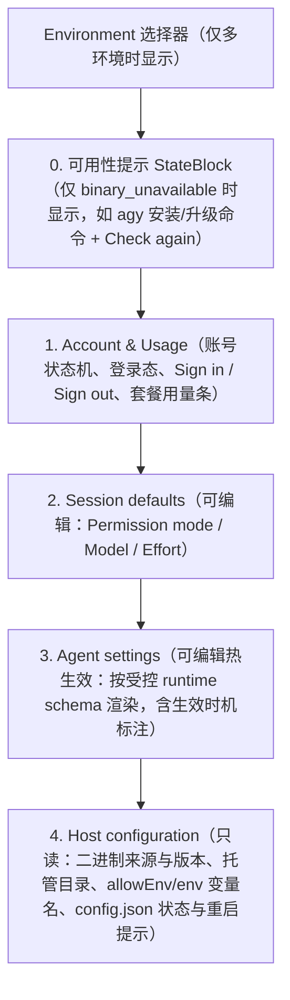

# Harness 设置与配置设计（Claude / Codex / Antigravity）

状态：设计方案与实现计划（已结合 PR #131 评审收敛协议与生命周期细节），尚未开始实现。验证与调研日期：2026-11-23。

对应决定笔记：[2026-11-23-harness-settings-account-login-and-runtime-config.md](../.agents/notes/2026-11-23-harness-settings-account-login-and-runtime-config.md)（取代 [2026-11-22-claude-config-status-not-values.md](../.agents/notes/2026-11-22-claude-config-status-not-values.md)）。

## 1. 背景与目标

Cycle 目前已支持 3 个 agent（`claude`、`codex`、`agy`），后续还会接入 `pi`。现有的 agent 配置分散在多处且存在明显断层：

- **设置页割裂**：Settings 目前只有平铺的 `Defaults` 页管理会话默认项（`mode` / `model` / `effort`），看不到账号登录态、套餐用量、二进制可用性/版本，也看不到宿主 `config.json` 的诊断信息。
- **登录与登出依赖终端**：界面无法直接发起账号登录或登出，也无法区分“未登录 / 订阅登录 / `config.json` 环境变量覆盖 / 未安装 / 配置写坏”。
- **运行开关不可热改**：`claude.warmStart`、`claude.progressSummaries`、`agy.sandbox`、`agy.telemetry` 等非敏感行为选项只能手改 `config.json` 并重启 daemon。

本方案将 Settings 重构为包含 **Harness 分组** 的导航结构，为每个 agent 提供统一、清晰的设置页：**上半区为账号与套餐用量（支持界面内订阅登录/登出），下半区为 Cycle 托管的 agent 层级配置（部分可编辑热生效，部分只读诊断）**。

## 2. 范围边界与安全红线

1. **只支持账号订阅登录，不做 API Key UI 配置**：
   - Claude / Codex / Antigravity 在本轮仅提供**订阅账号的登录与登出**；API Key / 自定义 Base URL / 多模型 provider 的 UI 配置留待接入 `pi` 时统一处理。
   - 若用户已在 `config.json` 的 `env` 里手写了密钥或 token（如 `ANTHROPIC_API_KEY`），界面仅**只读展示**生效来源（变量名），绝不返回值、不提供编辑。
2. **精确的 L1 凭证安全边界**：
   - **长期凭证永不经 L1**：任何 OAuth access token、refresh token、API key 永不经 L1 传输、永不进入前端状态或埋点。
   - **一次性授权码为短期凭证，仅内存透传**：在 hosted-callback 登录模式（Claude / agy 的 `"code"` 模式）下，用户粘贴的一次性 OAuth authorization code 经 `_cycle/agent_auth/submit` 仅在内存中短暂存在并立即写入登录子进程 stdin，**永不落盘、永不写入 session JSONL、永不进 `daemon.log` / 调试日志 / 错误对象 / crash report**。
   - **登录链接校验**：主进程打开任何来自 daemon 的 `authorizationUrl` 或 `verificationUrl` 前，必须经 `openableAuthorizationUrl`（`@cycle/oidc` 的 `allowedEndpoint`）校验。
   - **`agy` 硬红线不变**：绝不读取、解析、存储或转发 `agy` 的 OAuth token 文件；仅驱动 `agy acp --login` 与 `agy acp` `logout` RPC（见 [2026-11-23-agy-terms-distribution-and-telemetry.md](../.agents/notes/2026-11-23-agy-terms-distribution-and-telemetry.md)）。
   - **与 ACP `auth/*` 的关系**：当前 [protocol.md](protocol.md) 写明 L1 不使用 ACP 原生 `auth/*`。Phase 1 实施前会先更新 `docs/protocol.md`，明确引入 `_cycle/agent_auth/*` 作为 Cycle 面向多 agent 账号管理的自有 L1 扩展，不改变 ACP 会话层约定。
3. **只管 Cycle 托管配置，不碰 agent 原生配置与宿主目录**：
   - 不提供“切换到本机已有 `~/.claude` / `~/.codex` / `~/.gemini` 登录”的 UI 选项；始终默认使用 `<dataDir>/<id>` 隔离目录（用户手改 `config.json` 时只读标注为自定义）。
   - 不读写 agent 原生配置文件（`CLAUDE.md`、`settings.json`、`config.toml` 等）；`Plugins` 保留在 Connectors 页面。

## 3. 前置隔离探测结论（实现依据）

2026-11-23 在严格隔离的临时目录（`env -i`，未触碰本机任何真实目录或钥匙串）下，对仓库锁定的 3 个二进制做了只读实测探测：

- **Claude**：`2.1.327`（`@anthropic-ai/claude-agent-sdk@0.3.327`）
- **Codex**：`0.171.0`（`@openai/codex@0.171.0`）
- **Antigravity (`agy`)**：`1.5.15`

| 能力               | Claude (`2.1.327`)                                                                                                                                                                                                                                                   | Codex (`0.171.0`)                                                                                                                                                                                                                                             | Antigravity (`1.5.15`)                                                                                                                                                                                                                   |
| ------------------ | -------------------------------------------------------------------------------------------------------------------------------------------------------------------------------------------------------------------------------------------------------------------- | ------------------------------------------------------------------------------------------------------------------------------------------------------------------------------------------------------------------------------------------------------------- | ---------------------------------------------------------------------------------------------------------------------------------------------------------------------------------------------------------------------------------------- |
| **账号状态查询**   | `claude auth status --json`（约 0.3s）：返回 `loggedIn`、`authMethod`（`none`/`api_key`/`oauth_token`/`third_party` 等）、`apiProvider`、`apiKeySource`；OAuth 登录时附带 `email` / `organization` / `subscriptionType` / `loginExpiresAt`（SDK `AccountInfo` 同构） | `codex -c cli_auth_credentials_store="file" app-server` 的 `account/read` RPC：返回 `account`（`null` / `chatgpt { email, planType, workspaceName }` / `apiKey` / `amazonBedrock` / `gcp`）                                                                   | 无独立 `auth status` 子命令；用 `agy models` 探测（仅明确匹配 `Please sign in` 时判为 `signed_out`，其余非零退出区分网络/超时/未知，见 §5.5）；会话建立时从 `_meta.antigravity.tier` 缓存订阅档位并记录 `observedAt`                     |
| **OAuth 登录流程** | `claude auth login --claudeai`（配 `BROWSER=/usr/bin/true`）：`redirect_uri` 为 **`https://platform.claude.com/oauth/code/callback`**（非 localhost），stdout 打印授权 URL 并等待 stdin 粘贴 code → **本地与远端 SSH 同一套流程**                                    | `codex app-server` `account/login/start` + `account/login/cancel`：<br>- **同机回环**：`type: "chatgpt"`（回调 `127.0.0.1:1455`，自动完成）<br>- **跨主机 / 无回环**：`type: "chatgptDeviceCode"`（返回 `verificationUrl` + `userCode`，无需 localhost 回调） | `agy acp --login`（配 `BROWSER=/usr/bin/true`）：`redirect_uri` 为 **`https://antigravity.google/oauth-callback`**（非 localhost），stdout 打印 Google OAuth URL 并等待 stdin 粘贴授权码或跳转后完整 URL → **本地与远端 SSH 同一套流程** |
| **登出流程**       | `claude auth logout`（幂等，未登录亦 exit 0）                                                                                                                                                                                                                        | `codex app-server` `account/logout`（或 `codex logout`）                                                                                                                                                                                                      | `agy acp` 原生 RPC `logout`（实测返回 `{}`）                                                                                                                                                                                             |
| **套餐用量**       | 被动来自会话 `rate_limit_event` → daemon 内存 `_cycle/plan_usage`（5h / 7d / 按模型）；未对话前暂无数据                                                                                                                                                              | `account/rateLimits/read` **可主动随时查询**（5h / 7d 窗口），回合中亦自动推送更新                                                                                                                                                                            | `agy` 1.5.15 不暴露额度窗口，仅支持展示带 `observedAt` 的订阅档位                                                                                                                                                                        |

额外记录两条备忘（本轮不做 API Key，留待后续 `pi` / 多 provider 阶段参考）：

- 仅在环境变量传 `OPENAI_API_KEY` 时，`codex login status` 与 `account/read` 仍报未登录；Codex 需要经 `account/login/start { type: "apiKey" }` 或 `codex login --with-api-key` 写入 `$CODEX_HOME/auth.json`。
- `agy acp` 虽在 `initialize` 声明了 `gemini-api-key`，但仅设 `GEMINI_API_KEY` 环境变量直接 `session/new` 会报 `-32000`，必须先调 ACP `authenticate({ methodId: "gemini-api-key" })`。

## 4. 界面信息架构（Settings → Harness）

### 4.1 左侧分组导航

扩展 `packages/ui/src/react/page-layout.tsx` 支持分组标题（保持完整上下方向键 / Home / End 键盘导航）：

```text
Settings
├── General
├── Appearance
├── Environments
├── Shortcuts
│
├── HARNESS                    ← 分组标题（非可选项）
│   ├── [Claude Logo] Claude
│   ├── [Codex Logo]  Codex
│   └── [Agy Logo]    Antigravity
```

- Harness 子项按当前选中环境的 `_cycle/agents/list` 动态生成，未来加入 `pi` 时自动出现；旧版 daemon 不含某 agent 时自动不显示。
- 原 `Defaults` tab 移除，其内容作为每个 Harness 页的 “Session defaults” 区块。
- 当连接了多个环境时，Harness 页顶部显示共享的 **Environment 选择器**（仅本机连接时隐藏）。

### 4.2 单个 Harness 页布局（自上而下）



1. **Account & Usage（第一部分）**
   - **状态行**：`StatusDot` + 身份主标题（如邮箱 / `Signed in` / `Not signed in` / `Unable to verify`）+ 副标题（认证方式、订阅计划/工作区、过期时间、`tier` 观测时间，以及独立的 `config.json` 环境变量覆盖标识）。
   - **操作按钮**：
     - 未登录 / 可重登：`Sign in`（由 `ConnectionManager` 根据连接传输类型和 daemon 声明的模式自动选择并校验，见 §5.3；UI 不硬编码任何 agent 或传输判断，只按返回的 `flow.mode` 渲染对应弹窗/等待态）。
     - 已登录：`Sign out`（先弹 `ConfirmDialog` 确认，说明正在运行的会话不会被强制中断）。
     - `Refresh`：重查账号态；Codex 同时主动刷新套餐用量。
   - **套餐用量**：抽取 `packages/ui/src/react/context-details.tsx` 中的用量进度条为可复用组件 `PlanUsageBars`：
     - **Codex**：进页自动读 + 点 Refresh 刷新，显示 5 小时与每周窗口及重置倒计时。
     - **Claude**：展示 daemon 已收到的最新未过期窗口；尚无数据时显示温和说明“将在完成一次对话后显示”。
     - **Antigravity**：不渲染空白额度条；若已有档位信息则展示档位与 `observedAt` 相对时间。

2. **Session defaults（可编辑，下个新会话生效）**
   - 沿用现有 `AgentDefaultsFields` + `ConfigForm`，读写 `_cycle/agent_defaults/*`（`<dataDir>/agent-defaults.json`）。

3. **Agent settings（可编辑，热生效，不重启 daemon）**
   - 按 daemon 返回的封闭版本化 `runtime.schema`（§5.4）动态渲染，每项显示简短的生效时机说明，并支持“恢复默认/继承”：
     - **Claude**：`warmStart`（Switch）、`maxWarm`（整数 1–10，仅 `warmStart === true` 时可调）、`progressSummaries`（Switch）。
     - **Codex**：当前 schema 为空，不渲染该组。
     - **Antigravity**：`sandbox`（Switch）、`telemetry`（Switch，默认 `true`，遵循既有决定笔记不静默关闭；关闭时传 `--disable-telemetry`）。
   - UI 若遇到新版 daemon 返回的不认识的字段类型，降级为只读文本展示，不报错、不丢值。

4. **Host configuration（只读诊断，不经 UI 修改）**
   - **Binary**：来源（Built-in / Configured in `config.json` / System PATH / Missing）、路径与版本号（`agy` 同时展示最低版本要求 `>= 1.5.10`）。
   - **Managed directory**：`<dataDir>/<id>` 或标注 `Custom (config.json)`。
   - **Environment variables**：`allowEnv` 允许透传的变量名列表；`env` 中声明的变量名列表（**仅变量名，绝不返回值**）。
   - **`config.json` status**：文件路径（本机提供“在文件管理器中显示”，远端提供一键复制路径）；若文件存在语法/schema 报错则用 `StateBlock` 展示原错；若文件 mtime 晚于 daemon 启动时间，提示“配置文件已修改，重启 daemon 后生效”。

## 5. L1 协议、状态机与安全契约（`docs/protocol.md` & `packages/protocol`）

实现前先更新 [protocol.md](protocol.md)（新增“Harness 状态、认证与运行时配置”一节），再在 `packages/protocol/src/agent-setup.ts` 定义全部 Zod schema：

### 5.1 能力位扩展（`packages/protocol/src/meta.ts`）

- `CapabilitiesSchema` 新增：
  - `agentSetup: z.boolean().optional()`
  - `agentAuthModes: z.record(z.string(), z.array(z.enum(["browser", "code", "device_code"]))).optional()`（可选摘要；权威来源为 `_cycle/agent_setup/read` 的 `auth.signInModes`）
- 旧 daemon 未声明 `agentSetup: true` 时，Settings → Harness 页仍可用，仅展示 `Session defaults` 并隐藏需要新接口的区块（平滑降级）。

### 5.2 L1 方法与通知

| 方法 / 通知                      | 方向          | 参数                                                                                              | 返回 / 载荷                                                                                                                                                                                                                        |
| -------------------------------- | ------------- | ------------------------------------------------------------------------------------------------- | ---------------------------------------------------------------------------------------------------------------------------------------------------------------------------------------------------------------------------------- |
| `_cycle/agent_setup/read`        | C → D         | `{ agent, refreshUsage? }`                                                                        | `AgentSetupSnapshot`（含 `available`、`binary`、`auth`、`planUsage?`、`canRefreshUsage`、`runtime { schemaVersion, fields, values, overrides, revision, fileError? }`、`environment { configFile, dataDir, allowEnv, envNames }`） |
| `_cycle/agent_setup/set_runtime` | C → D         | `{ agent, patch: Record<string, boolean \| number \| string \| null>, expectedRevision: number }` | `{ values, overrides, revision }`（局部 patch；字段值为 `null` 表示删除 override 恢复继承 `config.json`/默认值；乐观锁冲突返回 `revision_conflict`；成功后广播 `_cycle/agent_setup_changed`）                                      |
| `_cycle/agent_auth/start`        | C → D         | `{ agent, mode?: "browser" \| "code" \| "device_code" }`                                          | `{ flowId, mode, expiresAt, authorizationUrl?, verificationUrl?, userCode? }`（不传 `mode` 时由 daemon 选默认非回环模式；传入 `mode` 时由 daemon 按能力清单强校验）                                                                |
| `_cycle/agent_auth/submit`       | C → D         | `{ flowId, code }`                                                                                | `{ ok: true }` 或固定错误码（仅用于 `"code"` 模式，一次提交即失效）                                                                                                                                                                |
| `_cycle/agent_auth/cancel`       | C → D         | `{ flowId }`                                                                                      | `{}`                                                                                                                                                                                                                               |
| `_cycle/agent_auth/logout`       | C → D         | `{ agent }`                                                                                       | `{}`（串行登出，释放旧账号未发言预热进程，清内存 `planUsage`/`tier`，广播 `_cycle/agent_setup_changed`）                                                                                                                           |
| `_cycle/agent_auth_completed`    | D → C（通知） | —                                                                                                 | `{ flowId, agent, ok, errorCode? }`（仅推送给发起连接，或仅携带不含凭证的状态；全局刷新走 `_cycle/agent_setup_changed`）                                                                                                           |
| `_cycle/agent_setup_changed`     | D → C（通知） | —                                                                                                 | `{ agent, revision? }`（广播给所有客户端刷新快照）                                                                                                                                                                                 |

### 5.3 登录模式协商与职责切分（契合 Cycle 传输无关架构）

Cycle 的既有架构约定是“**环境是客户端概念，daemon 只看到 unix socket 连接，不知道对面是本机还是 SSH 远端**”（见 [desktop.md](desktop.md)）。因此登录模式按三方分工协同决定，避免 UI 硬编码也避免 daemon 猜测传输层：

1. **Daemon 声明能力与约束**：`_cycle/agent_setup/read` 返回 `auth.signInModes`（有序数组），每项声明 `{ mode: "browser" | "code" | "device_code", requiresLocalLoopback: boolean }`：
   - Claude：`[{ mode: "code", requiresLocalLoopback: false }]`
   - Codex：`[{ mode: "browser", requiresLocalLoopback: true }, { mode: "device_code", requiresLocalLoopback: false }]`（若未来云沙箱 daemon 显式禁用本机回环，可仅暴露 `device_code`）
   - Antigravity：`[{ mode: "code", requiresLocalLoopback: false }]`
2. **主进程 `ConnectionManager` 按连接传输类型选模式**（而非 React UI）：
   - `local` 环境可优先选用 `requiresLocalLoopback: true` 的模式（Codex 走浏览器自动回调）；
   - `remote`（SSH / 未来远程传输）环境自动过滤掉 `requiresLocalLoopback: true` 的模式，优先选择 `device_code` / `code`。
3. **Daemon 二次校验**：`_cycle/agent_auth/start` 校验客户端请求的 `mode` 必须属于该 agent 当前允许的 `signInModes`，非法模式直接以 `-32602` 拒绝。

### 5.4 封闭且带版本的 Runtime Schema 协议类型

`runtime` 字段不使用任意开放 JSON Schema，收敛为封闭的、带版本号的协议结构：

```ts
type ApplyScope = "immediate" | "next_session" | "next_process_launch" | "daemon_restart";

type RuntimeField =
  | {
      key: string;
      kind: "boolean";
      default: boolean;
      applyScope: ApplyScope;
      enabledWhen?: { key: string; equals: boolean | string | number };
    }
  | {
      key: string;
      kind: "integer";
      min: number;
      max: number;
      step?: number;
      default: number;
      applyScope: ApplyScope;
      enabledWhen?: { key: string; equals: boolean | string | number };
    }
  | {
      key: string;
      kind: "enum";
      values: readonly string[];
      default: string;
      applyScope: ApplyScope;
      enabledWhen?: { key: string; equals: boolean | string | number };
    };
```

- 每个字段的文案由前端按稳定 `key` 在 i18n 字典中查找（回落到 `key`），避免协议透传自由文本。
- daemon 侧 `set_runtime` **绝不信任 UI 传入值**：必须经对应 harness 的 strict Zod schema 二次校验；未知 agent 或未知字段一律返回 `-32602`，越界整数返回 `-32602`。

### 5.5 账号状态机、认证流生命周期与错误码

#### 账号状态枚举（`auth.state`）

- `binary_unavailable`：二进制缺失、不可执行或版本低于最低要求（如 `agy < 1.5.10`）。
- `signed_out`：明确确认未登录（Claude `loggedIn: false`、Codex `account: null`、`agy models` 明确输出未登录提示）。
- `signing_in`：当前存在进行中的认证流。
- `signed_in`：明确确认已登录。
- `signing_out`：正在执行登出。
- `auth_unknown`：无法可靠判定登录态（含固定 `unknownReason`: `"network_error" | "timeout" | "probe_failed"`）。
- **独立只读覆盖标记**：`auth.viaEnv?: string`（如 `"ANTHROPIC_API_KEY"`）与 `auth.method`（`"subscription" | "api_key" | "oauth_token" | "third_party" | "none" | "unknown"`）独立于上述状态机，避免把“env 覆盖”与“账号状态”混成互斥单值。
- **Antigravity 档位时效**：`auth.account.tierObservedAt?: number` 记录 `_meta.antigravity.tier` 的最后观测毫秒时间戳，登出后清空。

#### 认证流安全与并发规则

- **单 agent 互斥**：同一 agent 同时只允许 1 个活跃认证流或登出操作（按 agent 维度的操作锁串行化）。并发发起第二个 `start` 时直接返回固定错误码 `auth_in_progress`，不强杀他人正在进行的登录。
- **`flowId` 绑定与一次性消费**：`flowId`（随机 UUID）绑定 `(connectionId, agent, flowId)`；只有发起连接可调用 `submit` / `cancel`。`submit` 在状态机中原子从 `pending → submitting` 转换，同一 `flowId` 只能提交一次，重复提交返回 `flow_consumed`。
- **`submit` 与 `cancel` 并发**：共享单向状态机（`pending → submitting | cancelled | expired → completed`），先占锁者生效，后到者返回 `flow_not_active`。
- **TTL 与断线/退出清理**：每个流程固定 TTL 10 分钟；当**发起连接断开**、**TTL 到期**或**daemon 关闭（`daemon.close()`）**时，立即终止对应登录子进程（Codex 调用 `account/login/cancel` 并关掉短生命周期 `app-server`；Claude / agy 发 `SIGTERM` 并在宽限后 `SIGKILL`），不留孤儿进程。
- **固定错误码（绝不透传原始 stderr/URL/路径）**：认证接口与通知仅返回固定枚举错误码：
  - `binary_unavailable` | `unsupported_mode` | `auth_in_progress` | `flow_not_found` | `flow_forbidden` | `flow_consumed` | `flow_not_active` | `invalid_code` | `expired` | `cancelled` | `process_failed` | `timeout` | `revision_conflict`
  - 诊断细节（经 `redactText` 脱敏、且绝不含 `code`）只记入 `daemon.log`，不通过 L1 返回给客户端。

#### 登出（Sign out）与运行中 Session 的生命周期规则

- **不中断正在工作的会话**：Sign out 不强杀正在运行 turn 或等待审批的 session（避免丢工作）。
- **立即回收旧账号未发言预热进程**：Sign out 立即终止该 agent 所有尚未发过 prompt 的 warm process（使 session 保持在列表但状态转为 `stopped`），防止下一个新会话继续携带旧账号内存态启动。
- **清理缓存状态**：立即清掉 daemon 内存中该 agent 的 `planUsage` 与 `tierObservedAt`，并广播 `_cycle/agent_setup_changed`。
- **后续新消息自然走未登录处理**：登出后不硬禁新建空白页，下次需要启动新 agent 进程时由 agent 返回未登录错误，空白页直接提供跳转 Harness 设置页重新登录。

## 6. Daemon 存储、并发与热生效架构

### 6.1 `<dataDir>/agent-settings.json` 存储与并发语义

- 新增 `apps/daemon/src/agent-settings.ts`（`AgentSettings` 类，沿用 `defaults-file.ts` 的串行写队列 + 临时文件 + 原子 `rename` 模式，文件权限 `0600`，格式 `{ version: 1, revision: number, agents: Record<string, Record<string, boolean | number | string>> }`）。
- **合并优先级**：`agent-settings.json`（显式 override） > `config.json`（启动时加载的宿主配置） > 字段 schema 默认值。
- **局部 Patch + Unset + 乐观锁**：
  - `set_runtime` 接收 `{ agent, patch, expectedRevision }`：逐字段校验后合入当前 agent 的 override map（值为 `null` 则删除该键恢复继承）；若 `expectedRevision !== currentRevision` 返回 `revision_conflict`，避免双客户端并发互覆。
- **损坏或未知版本恢复**：
  - 加载时若文件存在但 JSON/Zod 解析失败或 `version !== 1`，**绝不静默覆写原文件**（与 `DefaultsUnreadableError` 同原则），记错误日志并在 snapshot 中回传 `runtime.fileError`；daemon 仍可启动，运行时值回落到 `config.json` / 默认值，写入接口返回错误直至修复或移走损坏文件。
- **`config.json` 不自动重载**：`config.json` 只在 daemon 启动时读一次；人工修改后通过比较 `mtimeMs` 在诊断区标记 `configFile.stale = true` 并提示重启 daemon 后生效。

### 6.2 每个设置项的生效时机与 Warm Pool Reconciliation

| 配置项                                              | 来源                                  | 生效时机 (`applyScope`)      | 热变更与 Warm Pool 行为                                                                                                                                                                                                                                                                         |
| --------------------------------------------------- | ------------------------------------- | ---------------------------- | ----------------------------------------------------------------------------------------------------------------------------------------------------------------------------------------------------------------------------------------------------------------------------------------------- |
| `mode` / `model` / `effort`                         | `agent-defaults.json`                 | `next_session`               | 下次新建会话使用新默认值；已建会话不变                                                                                                                                                                                                                                                          |
| `claude.warmStart`                                  | `agent-settings.json` / `config.json` | `immediate` + `next_session` | **`true → false`**：立即调用 warm pool reconciliation，终止该 agent 所有**尚未发过 prompt**的预热进程（对应 session 留在列表中、状态变为 `stopped`，对话历史无损；已发言或运行中 session 不受影响），且后续新会话不再预热。<br>**`false → true`**：不回补已有未发言空会话，仅对后续新会话生效。 |
| `claude.maxWarm`                                    | `agent-settings.json` / `config.json` | `immediate`                  | **调低时**：立即执行 warm pool reconciliation，按既有 FIFO（最旧优先）回收超出新上限的未发言预热进程。<br>**调高时**：不主动补足旧空会话，允许后续新会话保留更多预热进程。                                                                                                                      |
| `claude.progressSummaries`                          | `agent-settings.json` / `config.json` | `next_process_launch`        | 仅影响下一次启动/重启的 Claude adapter 进程；已运行进程不变                                                                                                                                                                                                                                     |
| `agy.sandbox`、`agy.telemetry`                      | `agent-settings.json` / `config.json` | `next_process_launch`        | 仅影响下一次启动/重启的 `agy` adapter 进程；已运行进程不变                                                                                                                                                                                                                                      |
| `executable`、`configDir`/`home`、`allowEnv`、`env` | `config.json`（只读）                 | `daemon_restart`             | 需重启 daemon 后生效，UI 仅作只读诊断与 `stale` 提示                                                                                                                                                                                                                                            |

### 6.3 三个 Harness 的 `AgentSetupProvider` 与 `CODEX_HOME` 并发验证

`AgentDefinition`（`apps/daemon/src/agents.ts`）扩展 `maxAhead?: number | (() => number | undefined)` 与 `setup?: AgentSetupProvider`，保持 daemon 核心完全不按名字硬编码 agent：

- **Claude**（`apps/daemon/src/claude-setup.ts`）：`claude auth status --json`（5s 超时）、`claude auth login --claudeai`（`BROWSER=/usr/bin/true`，解析授权 URL + stdin 提交一次授权码）、`claude auth logout`。
- **Codex**（`apps/daemon/src/codex-setup.ts`）：短生命周期 `codex -c cli_auth_credentials_store="file" app-server` 执行 `account/read`、`account/rateLimits/read`、`account/login/start`（`chatgpt` / `chatgptDeviceCode`）、`account/login/cancel`、`account/logout`。
  - **`CODEX_HOME` 并发验证（前置实测项）**：认证 `app-server` 与普通 session 进程共享同一隔离 `$CODEX_HOME`（凭证均钉为文件模式 `auth.json`）。在实现 Codex provider 前，需在隔离集成测试中实测“运行中 session + 并发 `account/read` / `account/rateLimits/read` / `account/logout`”是否存在 SQLite 或文件锁冲突；若观测到冲突，则在 daemon 层通过 Codex setup 串行化或复用机制处理。
- **Antigravity**（`apps/daemon/src/agy-setup.ts`）：复用 `findAgyExecutable` + 版本校验；`agy models`（5s 超时）区分 `signed_in` / `signed_out`（严格匹配未登录文本）/ `auth_unknown`（网络错误/超时/其它非零退出）；`agy acp --login`（`BROWSER=/usr/bin/true`，授权 URL + stdin 提交一次授权码）；短生命周期 `agy acp` 执行 `logout` RPC。

### 6.4 桌面端主进程与空白页联动

- **主进程**（`apps/desktop/src/main/manager.ts` / `dispatch.ts` / `app.ts`）：
  - 桥接全部 `agentSetup` / `agentAuth` 方法到 `AppApi`；对本地环境提供 `revealDaemonConfig()`（`shell.showItemInFolder`）。
  - `ConnectionManager` 根据环境的 `kind`（`local` vs `remote`）与 daemon 声明的 `signInModes` 选定登录模式；收到授权 URL 后经 `openableAuthorizationUrl` 校验，由 `shell.openExternal` 打开浏览器。
- **空白页联动**（`packages/ui/src/react/blank.tsx`）：
  - 当会话因未登录（`-32000`）或 agent 不可用失败且 daemon 支持 `agentSetup` 时，除保留复制命令外，增加直达对应 Harness 设置页的操作按钮（`Open <Agent> settings`）。

## 7. 埋点设计（`packages/analytics` & `docs/analytics.md`）

严格遵守“只报行为、不报内容、禁用 `z.string()`”规则（见 [analytics.md](analytics.md)），所有属性必须经固定枚举或分类函数映射：

- `settingsSection` 更新为 `z.enum(["general", "appearance", "environments", "shortcuts", "harness"])`（同步 `SETTINGS_SECTIONS` 与 `apps/desktop/test/preferences.test.ts`）。
- 复用既有固定枚举与映射函数：
  - `agent`：`z.enum(["claude", "codex", "agy", "pi", "other"])`（经 `agentOf()` 映射，绝不透传任意插件/agent 字符串）
  - `environment`：`z.enum(["local", "remote"])`（绝不上报环境名称、ID、主机名或路径）
  - `mode`：`z.enum(["browser", "code", "device_code"])`
- 新增事件（同步写入 `packages/analytics/src/events.ts` 与 `docs/analytics.md`）：
  - `harness_settings_shown`: `{ agent, environment }`（UI 事件）
  - `agent_auth_started`: `{ agent, environment, mode }`（主进程上报）
  - `agent_auth_completed`: `{ agent, environment, result: z.enum(["ok", "failed", "cancelled"]) }`（主进程上报）
  - `agent_signed_out`: `{ agent, environment, ok: z.boolean() }`（主进程上报）
  - `agent_runtime_settings_saved`: `{ agent, environment }`（主进程上报）
- **明确不上报**：email、organization、plan 原始名、文件路径、环境变量名、授权码、URL、错误信息原文。

## 8. 分阶段实现与验证计划（先纵向打通 Claude，再横向扩展）

采纳评审建议，采用**纵向优先、先验证后抽象**的推进顺序：

### Phase 1：协议定稿与 `@cycle/protocol`

- 更新 [protocol.md](protocol.md)：定义 `agentSetup` 能力位、`AgentSetupSnapshot`、封闭版本化 `RuntimeField` schema、`_cycle/agent_setup/*`、`_cycle/agent_auth/*`、固定错误码、状态机与通知，并明确一次性授权码的内存透传安全约束与与 ACP `auth/*` 的边界。
- 新增 `packages/protocol/src/agent-setup.ts`，更新 `packages/protocol/src/meta.ts`、`index.ts` 及单元测试。

### Phase 2：纵向打通 Claude（Daemon + `AgentSettings` + 热生效 + 全边界验证）

- 新增 `apps/daemon/src/agent-settings.ts`（局部 patch、unset、乐观锁 `expectedRevision`、损坏保护）与 `apps/daemon/src/daemon.ts` 中的认证流管理器（连接绑定、单 agent 互斥、单次提交、TTL、断线/退出清理）及 warm pool reconciliation。
- 完整实现 `apps/daemon/src/claude-setup.ts`（`readAuth`、`startLogin("code")`、`submit`、`cancel`、`logout`、`warmStart`/`maxWarm`/`progressSummaries` 热生效）。
- 重点验证：本地 daemon、SSH 远程 daemon、断线重连清理登录子进程、daemon 重启、双客户端并发修改（`revision_conflict`）与并发登录（`auth_in_progress`）、运行中 session 登出与 `warmStart`/`maxWarm` 实时回收。

### Phase 3：横向扩展 Codex 与 Antigravity

- 仅提炼经 Claude 与二/三号 provider 共同验证过的 `AgentSetupProvider` 最小公共抽象。
- 实现 `codex-setup.ts`（含 `$CODEX_HOME` 并发 session + `account/read`/`rateLimits/read`/`logout` 隔离集成实测、本地 `browser` 与远端 `device_code` 登录流）。
- 实现 `agy-setup.ts`（`agy models` 精细区分 `signed_in`/`signed_out`/`auth_unknown`、`tierObservedAt`、`agy acp --login`、`agy acp` `logout`、`sandbox`/`telemetry` 热生效，以及“绝不触碰 token 文件”红线单测）。

### Phase 4：`@cycle/client`、桌面端主进程/预加载、埋点与 Harness UI

- 在 `packages/client` 封装全部 L1 方法与事件订阅，补齐单元测试。
- 在 `apps/desktop/src/main`（`manager.ts`、`dispatch.ts`、`app.ts`）、`preload`、`packages/ui/src/api.ts` 接入 IPC、由 `ConnectionManager` 按连接类型选择登录模式、`openableAuthorizationUrl` 校验、本地 `revealDaemonConfig` 及完整埋点测试（证明不泄露任何敏感字段）。
- 升级 `PageLayout` 支持分组导航，移除 `Defaults` tab，抽取 `PlanUsageBars`，新增 `packages/ui/src/react/harness-settings.tsx`（含旧 daemon 降级、未知字段只读降级、登录取消/超时/重复提交/远程 Device Code/断线场景），联动 `blank.tsx` 并补齐中英文 i18n。

### Phase 5：全量验证与文档同步

- 运行门禁 `bun run check`（边界、css、类型、lint、全部单测）。
- 编写并运行浏览器 UI 测试 `bun run test:browser`（覆盖分组导航、3 个 Harness 页状态机、登录/登出/取消/超时/重复提交/Device Code、运行时开关热保存与乐观锁冲突、只读诊断与旧 daemon 降级）。
- 运行集成测试 `bun run test:integration`。
- 更新 [daemon.md](daemon.md) 与 [desktop.md](desktop.md) 对应章节。
